# BỘ GIÁO TRÌNH LÝ THUYẾT & KIẾN TRÚC CHUYÊN SÂU: SPRING SECURITY 7.x

_(Nền tảng: Java 21+ | Spring Boot 4.x | Spring Framework 7.x | Spring Security 7.x)_

---

## CHƯƠNG 1: NỀN TẢNG TƯ DUY BẢO MẬT WEB & RANH GIỚI KIẾN TRÚC

### 1. ĐẶT VẤN ĐỀ & CÂU HỎI TRỌNG TÂM

#### Bài toán thực tế trên mạng xã hội InstaClone

Trong giai đoạn đầu phát triển nền tảng mạng xã hội InstaClone, đội ngũ kỹ thuật triển khai các tính năng cốt lõi: đăng bài viết (`POST /api/v1/posts`), xem bảng tin khám phá (`GET /api/v1/feed/public`), bình luận (`POST /api/v1/posts/{id}/comments`) và xóa bài đăng vi phạm (`DELETE /api/v1/posts/{id}`).

Để kiểm soát quyền truy cập trước khi đưa framework bảo mật vào, lập trình viên thường chọn giải pháp nhanh:

1. Viết mã kiểm tra thủ công bằng câu lệnh điều kiện `if/else` rải rác ngay bên trong các tầng `Service` hoặc `Controller`.
2. Sử dụng `HandlerInterceptor` của Spring MVC để chặn các request đến dựa trên đường dẫn URL.

**Thảm họa kiến trúc và an ninh xảy ra:**

- **Ô nhiễm mã nguồn (Code Pollution) & Vi phạm SRP:** Logic kiểm tra phiên làm việc và vai trò bị cài cắm khắp nơi. Khi nghiệp vụ thay đổi hoặc cần bổ sung kiểm toán (audit log), toàn bộ codebase bị ảnh hưởng.
- **Lọt ranh giới tin cậy (Trust Boundary Bypass):** `HandlerInterceptor` nằm hoàn toàn bên trong `DispatcherServlet`. Khi một lập trình viên cấu hình thêm một Servlet phục vụ file media tĩnh (`/uploads/**`) hoặc một endpoint kiểm tra sức khỏe của container/Actuator nằm ngoài tầm quét của Spring MVC, toàn bộ cơ chế bảo vệ bị vô hiệu hóa hoàn toàn. Kẻ tấn công có thể truy cập trực tiếp tài nguyên mà không cần thông qua interceptor.
- **Lỗ hổng nhầm lẫn phương thức HTTP:** Việc khớp chuỗi lỏng lẻo trong interceptor (ví dụ: chỉ kiểm tra `/api/v1/posts/*` mà quên ràng buộc HTTP Verb `DELETE`) cho phép người dùng thông thường gửi request sửa đổi/xóa bài viết của người khác.

#### Câu hỏi tư duy trọng tâm

> _Tại sao việc đặt logic bảo vệ người dùng tại Spring MVC HandlerInterceptor hoặc AOP Service lại không bao giờ được coi là "tường lửa vững chắc" (Perimeter Defense), và bản chất kiến trúc Servlet Filter giải quyết triệt để ranh giới tin cậy (Trust Boundary) như thế nào trước khi request chạm tới tầng ứng dụng?_

---

### 2. PHÂN TÍCH KIẾN TRÚC & CƠ CHẾ NỘI TẠI (UNDER THE HOOD)

#### 2.1. Phân định các khái niệm cốt lõi (Core Terminology)

Để thiết kế một hệ thống chuẩn mực, các ranh giới khái niệm phải được phân tách rõ ràng:

- **Identification (Định danh):** Quá trình Client tuyên bố mình là ai (ví dụ: gửi `username`, địa chỉ email hoặc `API-Key`).
- **Credentials (Chứng thư / Bằng chứng):** Bằng chứng chứng minh danh tính đó là có thật và chính chủ (mật khẩu, chữ ký số private key, mã OTP, sinh trắc học).
- **Authentication (Xác thực):** Hành động đối chiếu Credentials với cơ sở dữ liệu xác thực để khẳng định danh tính. Trả lời câu hỏi: _"Bạn có đúng là người bạn nhận hay không?"_.

- **Principal:** Đối tượng đại diện cho danh tính đã được xác thực thành công trong hệ thống (thường là một thực thể `UserDetails` chứa `userId`, `username`).
- **GrantedAuthority & Roles (Quyền hạn và Vai trò):** Quyền hạn chi tiết được cấp phát cho Principal (ví dụ: `POST_DELETE`, `COMMENT_READ`). Role là một tập hợp các quyền mang tính ngữ nghĩa nghiệp vụ cao hơn (ví dụ: `ROLE_MODERATOR`, `ROLE_ADMIN`).

- **Authorization (Phân quyền / Ủy quyền):** Quá trình quyết định xem Principal hiện tại có đủ đặc quyền để thực thi thao tác trên một tài nguyên cụ thể hay không. Trả lời câu hỏi: _"Bạn có được phép làm điều này không?"_.

- **Security Boundary & Trust Boundary:** Ranh giới ngăn cách giữa môi trường không tin cậy (mạng công cộng, Client phía trình duyệt/mobile) và vùng tin cậy nội bộ (Database, Business Services, File Storage). Mọi request phải được lọc sạch tại ranh giới trước khi vào vùng tin cậy.

#### 2.2. Ranh giới kiến trúc: Servlet Filter vs. Spring MVC HandlerInterceptor

Sự khác biệt mang tính sống còn giữa hai cơ chế nằm ở vị trí thực thi trong vòng đời của một HTTP Request trên Web Server:

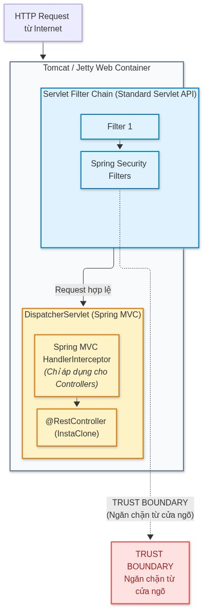

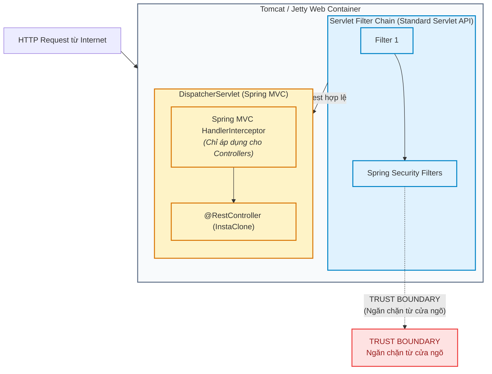

- **Servlet Filter (Cơ chế của Spring Security):** Nằm ở tầng Servlet Container chuẩn (Jakarta EE). Bộ lọc này chặn request **trước** khi `DispatcherServlet` được kích hoạt. Nếu một request không hợp lệ hoặc có dấu hiệu tấn công, Filter có thể phản hồi mã lỗi `401 Unauthorized` hoặc `403 Forbidden` ngay lập tức, hoàn toàn không tốn tài nguyên khởi tạo context của Spring MVC, không gọi Reflection và ngăn ngừa tuyệt đối các cuộc tấn công khai thác vào tầng Controller.
- **Spring MVC HandlerInterceptor:** Nằm bên trong `DispatcherServlet`. Interceptor chỉ được kích hoạt khi request đã được `HandlerMapping` xác định là thuộc về một `@Controller` cụ thể. Do đó:
- Không thể bảo vệ các tài nguyên không thuộc `DispatcherServlet` (ví dụ: Direct Servlets, Static Resources được cấu hình độc lập, WebSocket handshake sơ khai, Filter-based endpoints).
- Xử lý ngoại lệ bảo mật trong Interceptor phức tạp hơn vì nó chịu sự chi phối của cơ chế xử lý lỗi của Spring MVC (`@ControllerAdvice`).

#### 2.3. Nguyên tắc đặc quyền tối thiểu (Least Privilege)

Trong InstaClone, một tài khoản người dùng bình thường (`ROLE_USER`) tuyệt đối không được cấp bất kỳ quyền hạn nào vượt quá phạm vi hoạt động của họ. Khi thiết kế hệ thống:

1. Mọi endpoint mặc định phải bị **chặn truy cập** (`deny-by-default` hoặc `authenticated`), chỉ mở công khai những endpoint thực sự cần thiết như xem feed chung (`/api/v1/feed/public/**`).

2. Quyền xóa bài viết của người khác (`POST_DELETE_ANY`) chỉ dành riêng cho `ROLE_MODERATOR` và `ROLE_ADMIN`.

---

### 3. MINH HỌA CODE CHUẨN MỰC TRÊN INSTACLONE

Dưới đây là mô hình phân ranh giới chuẩn mực cho InstaClone trên nền tảng Java 21, minh họa rõ sự tách biệt giữa DTO, Domain Model và việc định nghĩa quyền.

#### 3.1. Domain Entities & Role Definitions

```java
package com.instaclone.domain.entity;

import jakarta.persistence.*;
import java.time.Instant;
import java.util.HashSet;
import java.util.Set;

@Entity
@Table(name = "users")
public class User {

    @Id
    @GeneratedValue(strategy = GenerationType.IDENTITY)
    private Long id;

    @Column(nullable = false, unique = true, length = 50)
    private String username;

    @Column(nullable = false, length = 255)
    private String password;

    @Column(nullable = false, unique = true, length = 100)
    private String email;

    @ElementCollection(fetch = FetchType.EAGER)
    @CollectionTable(name = "user_roles", joinColumns = @JoinColumn(name = "user_id"))
    @Column(name = "role", nullable = false)
    private Set<String> roles = new HashSet<>();

    // Constructors, Getters, Setters chuẩn mực
    public User() {}

    public User(String username, String password, String email, Set<String> roles) {
        this.username = username;
        this.password = password;
        this.email = email;
        this.roles = roles;
    }

    public Long getId() { return id; }
    public String getUsername() { return username; }
    public String getPassword() { return password; }
    public Set<String> getRoles() { return roles; }
}

```

```java
package com.instaclone.domain.entity;

import jakarta.persistence.*;
import java.time.Instant;

@Entity
@Table(name = "posts")
public class Post {

    @Id
    @GeneratedValue(strategy = GenerationType.IDENTITY)
    private Long id;

    @Column(nullable = false, length = 1000)
    private String caption;

    @Column(nullable = false)
    private String imageUrl;

    @ManyToOne(fetch = FetchType.LAZY, optional = false)
    @JoinColumn(name = "user_id", nullable = false)
    private User author;

    @Enumerated(EnumType.STRING)
    @Column(nullable = false)
    private PostVisibility visibility = PostVisibility.PUBLIC;

    @Column(nullable = false, updatable = false)
    private Instant createdAt = Instant.now();

    public enum PostVisibility {
        PUBLIC, FOLLOWERS_ONLY, PRIVATE
    }

    public Post() {}

    public Post(String caption, String imageUrl, User author, PostVisibility visibility) {
        this.caption = caption;
        this.imageUrl = imageUrl;
        this.author = author;
        this.visibility = visibility;
    }

    public Long getId() { return id; }
    public String getCaption() { return caption; }
    public String getImageUrl() { return imageUrl; }
    public User getAuthor() { return author; }
    public PostVisibility getVisibility() { return visibility; }
}

```

#### 3.2. Chống mẫu chống thiết kế (Anti-Pattern Demo: HandlerInterceptor)

Dưới đây là ví dụ minh họa cách làm **sai lầm** mà một số lập trình viên cố gắng áp dụng và lý do nó thất bại trong việc thiết lập Trust Boundary vững chắc:

```java
package com.instaclone.infrastructure.security.antipattern;

import jakarta.servlet.http.HttpServletRequest;
import jakarta.servlet.http.HttpServletResponse;
import org.springframework.web.servlet.HandlerInterceptor;

/**
 * CẢNH BÁO: Đây là Anti-pattern. Tuyệt đối KHÔNG dùng HandlerInterceptor
 * để thay thế Security Filter Chain trong kiến trúc bảo mật cấp doanh nghiệp.
 */
public class FragileSecurityInterceptor implements HandlerInterceptor {

    @Override
    public boolean preHandle(HttpServletRequest request, HttpServletResponse response, Object handler) throws Exception {
        String path = request.getRequestURI();
        String method = request.getMethod();

        // SAI LẦM 1: So khớp chuỗi thủ công rất dễ sót trường hợp
        // Kẻ tấn công có thể dùng Path Traversal, URL Encoding hoặc Matrix Variables để vượt qua
        if (path.startsWith("/api/v1/posts/") && "DELETE".equalsIgnoreCase(method)) {
            String roleHeader = request.getHeader("X-User-Role"); // Giả lập đọc header

            // SAI LẦM 2: Dựa vào thông tin chưa được kiểm chứng từ Client
            if (roleHeader == null || !roleHeader.contains("ADMIN")) {
                response.sendError(HttpServletResponse.SC_FORBIDDEN, "Forbidden: Insufficient privileges");
                return false;
            }
        }

        // SAI LẦM 3: Nếu request không map trúng bất kỳ @Controller nào, interceptor này bị bỏ qua,
        // nhưng request vẫn có thể rơi vào các ResourceHandler phục vụ file tĩnh chứa dữ liệu nhạy cảm.
        return true;
    }
}

```

---

### 4. BẪY LỖI KINH ĐIỂN & RỦI RO BẢO MẬT (GOTCHAS & PITFALLS)

- **Bẫy 1: Nhầm lẫn giữa Authentication (401) và Authorization (403)**
- _Hiện tượng:_ Trả về mã lỗi `403 Forbidden` khi người dùng chưa đăng nhập, hoặc trả về `401 Unauthorized` khi người dùng đã đăng nhập nhưng cố tình truy cập vào tài nguyên của Moderator.
- _Hệ quả:_ Làm sai lệch hành vi của Frontend (Client không biết khi nào cần điều hướng sang trang Login, khi nào cần báo lỗi quyền hạn) và vi phạm chuẩn thiết kế RESTful.
- _Khắc phục:_ Nhớ quy tắc bất biến: `401 Unauthorized` nghĩa là "Chưa xác thực danh tính (Unauthenticated) - Hãy đưa bằng chứng danh tính hợp lệ"; `403 Forbidden` nghĩa là "Đã biết danh tính nhưng không đủ thẩm quyền (Unauthorized Access) - Không được phép truy cập".

- **Bẫy 2: Tin tưởng tuyệt đối vào cơ chế lọc ở tầng Frontend**
- _Hiện tượng:_ Lập trình viên ẩn nút "Xóa bài viết" trên ứng dụng Web/Mobile đối với người dùng không phải chủ bài đăng hoặc Moderator, nhưng ở Backend Controller lại không kiểm tra quyền sở hữu bài viết khi nhận request `DELETE /api/v1/posts/102`.
- _Hệ quả:_ Gây ra lỗ hổng nghiêm trọng **BOLA (Broken Object Level Authorization)** / **IDOR**. Bất kỳ ai sử dụng Postman hoặc `curl` đều có thể xóa sạch bài viết trên hệ thống.
- _Khắc phục:_ Frontend chỉ quản lý trải nghiệm người dùng (UX), Backend bắt buộc phải tái thẩm định quyền ở mọi request.

---

### 5. BỘ CÂU HỎI TƯ DUY & PHẢN BIỆN (DEEP-DIVE QUESTIONS)

1. _Một request gửi tới endpoint `POST /api/v1/posts` bị từ chối với mã lỗi HTTP 401, trong khi một request khác gửi tới `DELETE /api/v1/posts/45` bị từ chối với mã lỗi HTTP 403. Hãy phân tích trạng thái bảo mật của hệ thống và trạng thái của người dùng trong hai tình huống trên._
2. _Nếu một lập trình viên cấu hình bảo mật bằng một Servlet Filter tự viết độc lập và đặt thứ tự ưu tiên (Order) chạy sau `DispatcherServlet`, kiến trúc này có gặp rủi ro gì không? Tại sao Spring Security luôn tìm cách đứng ở đầu chuỗi lọc?_

---

---

## CHƯƠNG 2: KIẾN TRÚC FILTER CHAIN & CẤU HÌNH HIỆN ĐẠI SPRING SECURITY 7.x

### 1. ĐẶT VẤN ĐỀ & CÂU HỎI TRỌNG TÂM

#### Bài toán thực tế trên mạng xã hội InstaClone

Khi InstaClone tích hợp Spring Security, hệ thống phải đáp ứng đồng thời nhiều yêu cầu:

1. Endpoint bảng tin công khai `GET /api/v1/feed/public/**` phải mở cho tất cả mọi người (kể cả khách vãng lai chưa đăng ký tài khoản).

2. Endpoint quản lý bài đăng `POST /api/v1/posts/**` và thông tin cá nhân `GET /api/v1/users/me` bắt buộc phải được xác thực danh tính.

3. Hệ thống phải sẵn sàng kiểm soát tần suất gửi request (Rate Limiting) để chống spam bình luận mà không làm ảnh hưởng đến hiệu năng của các API khác.

Nhiều lập trình viên khi nâng cấp từ các phiên bản cũ (Spring Security 5.x/6.x) lên **Spring Security 7.x** (chạy trên Spring Framework 7 và Spring Boot 4) thường gặp lỗi biên dịch nghiêm trọng do thói quen:

- Tìm cách kế thừa lớp `WebSecurityConfigurerAdapter` (đã bị xóa bỏ hoàn toàn).

- Sử dụng nối chuỗi `.and()` (đã bị xóa bỏ).

- Khai báo `AntPathRequestMatcher` hoặc `MvcRequestMatcher` (đã bị loại bỏ khỏi Spring Security 7.0 để thống nhất sang công nghệ khớp URL mới).

#### Câu hỏi tư duy trọng tâm

> _Làm cách nào mà một Spring Bean (nằm trong Spring ApplicationContext) có thể chặn và xử lý các HTTP Request được quản lý bởi Web Container (như Apache Tomcat) vốn nằm ngoài ranh giới của Spring IoC? Và tại sao kiến trúc cấu hình của Spring Security 7.x lại bắt buộc sử dụng Lambda DSL kết hợp PathPatternRequestMatcher?_

---

### 2. PHÂN TÍCH KIẾN TRÚC & CƠ CHẾ NỘI TẠI (UNDER THE HOOD)

#### 2.1. Cầu nối giữa Servlet Container và Spring IoC: DelegatingFilterProxy & FilterChainProxy

Web Container (như Tomcat) quản lý vòng đời của các Servlet Filter thông qua đặc tả Servlet API chuẩn. Tuy nhiên, các Filter bảo mật cần tương tác với Database, cấu hình và các Spring Bean khác. Để giải quyết mâu thuẫn này, Spring Security sử dụng mẫu thiết kế Proxy:

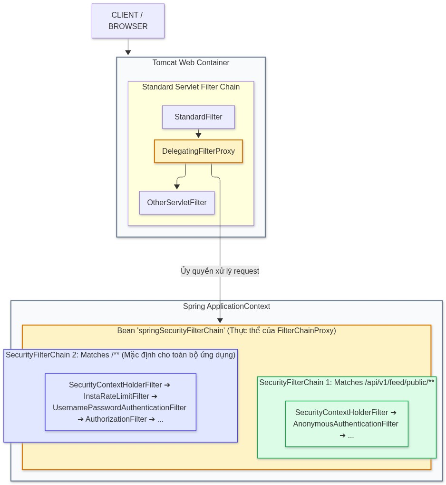

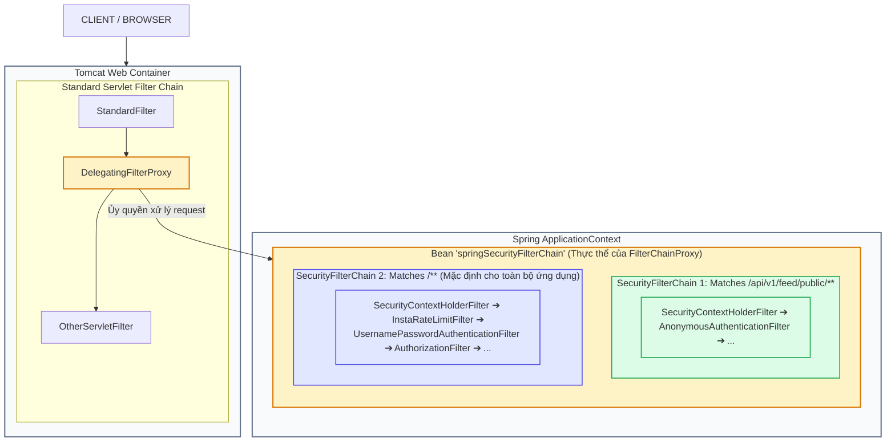

1. **`DelegatingFilterProxy`:**

- Là một Servlet Filter tiêu chuẩn được đăng ký với Servlet Container.

- Nhiệm vụ duy nhất của nó là nhận `HttpServletRequest` từ Container, sau đó tìm kiếm một Spring Bean có tên chuẩn là `springSecurityFilterChain` trong Spring IoC Context và ủy quyền toàn bộ việc xử lý cho Bean này.

2. **`FilterChainProxy`:**

- Là một Spring Bean thực thụ, đóng vai trò là điểm điều phối trung tâm của toàn bộ hệ thống bảo mật.

- `FilterChainProxy` quản lý một danh sách gồm một hoặc nhiều `SecurityFilterChain`.

- Khi nhận request từ `DelegatingFilterProxy`, `FilterChainProxy` sẽ duyệt qua danh sách các `SecurityFilterChain` và chọn chuỗi lọc **đầu tiên** có cấu hình khớp với URL và HTTP Method của request đó.

3. **`SecurityFilterChain`:**

- Là một Interface chứa danh sách các Filter bảo mật cụ thể (`List<Filter>`) cùng một `RequestMatcher` để kiểm tra điều kiện kích hoạt.

- Các Filter bên trong được sắp xếp theo một thứ tự nghiêm ngặt (ví dụ: `SecurityContextHolderFilter` luôn chạy trước các Authentication Filters, và `AuthorizationFilter` luôn chạy ở cuối chuỗi).

#### 2.2. Sự đột phá kiến trúc trong Spring Security 7.x

##### Loại bỏ hoàn toàn AntPathRequestMatcher và MvcRequestMatcher để chuẩn hóa PathPatternRequestMatcher

- _Lịch sử:_ Ở các phiên bản trước, việc khớp đường dẫn URL thường xảy ra bất đồng bộ giữa cơ chế của Spring MVC (sử dụng `PathPatternParser` hiệu năng cao) và Spring Security (sử dụng `AntPathMatcher` cổ điển). Điều này từng dẫn đến các lỗ hổng bảo mật nghiêm trọng liên quan đến cách hiểu URL khác nhau (ví dụ: `/api/v1/posts` khác `/api/v1/posts/`).
- _Chuẩn Spring Security 7.x:_ Loại bỏ toàn bộ `AntPathRequestMatcher` và `MvcRequestMatcher`. Mọi thao tác so khớp URL đều được chuẩn hóa và thực thi thông qua **`PathPatternRequestMatcher`** dựa trên nền tảng `PathPatternParser` của Spring Framework 7, mang lại tốc độ biên dịch regex tối ưu và triệt tiêu hoàn toàn rủi ro sai lệch khớp mẫu URL.

##### Lambda DSL bắt buộc & Xóa bỏ chuỗi `.and()`

- Phương thức `.and()` tạo ra các chuỗi cấu hình dài, khó bảo trì, dễ gây nhầm lẫn scope giữa các nhánh con.
- Spring Security 7.x bắt buộc 100% sử dụng **Lambda DSL**. Mọi cấu hình thành phần (`authorizeHttpRequests`, `csrf`, `sessionManagement`) đều nhận một `Customizer<T>` functional interface, giúp cấu trúc mã nguồn thụt lề rõ ràng, độc lập và dễ đọc.

##### Cấu hình phân mô-đun với `Customizer<HttpSecurity>`

Spring Security 7.x khuyến khích kiến trúc cấu hình dạng mô-đun (Component-based Configuration). Thay vì nhồi nhét tất cả logic vào một phương thức `securityFilterChain` khổng lồ, lập trình viên có thể định nghĩa các Bean `Customizer<HttpSecurity>` chuyên biệt để tùy chỉnh từng phần mà không ghi đè cấu hình bảo mật mặc định của Spring Boot.

---

### 3. MINH HỌA CODE CHUẨN MỰC TRÊN INSTACLONE

Dưới đây là mã nguồn cấu hình hoàn chỉnh theo chuẩn Spring Security 7.x và cách viết Custom Filter chuẩn mực.

#### 3.1. Cấu hình `SecurityConfig` hiện đại với Lambda DSL

```java
package com.instaclone.infrastructure.security.config;

import com.instaclone.infrastructure.security.filter.InstaRateLimitFilter;
import org.springframework.context.annotation.Bean;
import org.springframework.context.annotation.Configuration;
import org.springframework.core.annotation.Order;
import org.springframework.http.HttpMethod;
import org.springframework.security.config.Customizer;
import org.springframework.security.config.annotation.web.builders.HttpSecurity;
import org.springframework.security.config.annotation.web.configuration.EnableWebSecurity;
import org.springframework.security.web.SecurityFilterChain;
import org.springframework.security.web.authentication.UsernamePasswordAuthenticationFilter;

@Configuration
@EnableWebSecurity
public class SecurityConfig {

    private final InstaRateLimitFilter rateLimitFilter;

    // Dependency Injection chuẩn cho Custom Filter
    public SecurityConfig(InstaRateLimitFilter rateLimitFilter) {
        this.rateLimitFilter = rateLimitFilter;
    }

    /**
     * Cấu hình SecurityFilterChain chính cho toàn bộ API của InstaClone.
     * Sử dụng 100% cú pháp Lambda DSL và chuẩn khớp mẫu Spring Security 7.x.
     */
    @Bean
    public SecurityFilterChain securityFilterChain(HttpSecurity http) throws Exception {
        http
            // 1. Phân quyền ở mức Request Matchers
            .authorizeHttpRequests(authorize -> authorize
                // Công khai bảng tin chung và đăng ký/đăng nhập
                .requestMatchers(HttpMethod.GET, "/api/v1/feed/public/**").permitAll()
                .requestMatchers(HttpMethod.POST, "/api/v1/auth/**").permitAll()

                // Quyền quản lý kiểm duyệt dành cho Moderator và Admin
                .requestMatchers("/api/v1/moderation/**").hasAnyRole("MODERATOR", "ADMIN")

                // Mọi request còn lại đều bắt buộc phải được xác thực
                .anyRequest().authenticated()
            )

            // 2. Kích hoạt HTTP Basic Authentication với thiết lập chuẩn mặc định
            .httpBasic(Customizer.withDefaults())

            // 3. Chèn Custom Rate Limit Filter vào trước Filter xác thực người dùng
            .addFilterBefore(rateLimitFilter, UsernamePasswordAuthenticationFilter.class);

        return http.build();
    }
}

```

#### 3.2. Cấu hình Mô-đun với `Customizer<HttpSecurity>`

Trong các hệ thống phân tán hoặc dự án lớn, ta có thể viết các mô-đun bảo mật riêng biệt (ví dụ: Audit Log, CORS policy) và xuất ra dưới dạng Bean:

```java
package com.instaclone.infrastructure.security.config;

import org.springframework.context.annotation.Bean;
import org.springframework.context.annotation.Configuration;
import org.springframework.security.config.Customizer;
import org.springframework.security.config.annotation.web.builders.HttpSecurity;

@Configuration
public class ModularSecurityConfig {

    /**
     * Tự động áp dụng các header bảo mật nâng cao mà không làm phình to hàm config chính.
     */
    @Bean
    public Customizer<HttpSecurity> securityHeadersCustomizer() {
        return http -> {
            try {
                http.headers(headers -> headers
                    .contentSecurityPolicy(csp -> csp
                        .policyDirectives("default-src 'self'; script-src 'self'")
                    )
                );
            } catch (Exception e) {
                throw new IllegalStateException("Failed to configure security headers", e);
            }
        };
    }
}

```

#### 3.3. Custom Filter kiểm soát tần suất: `InstaRateLimitFilter`

Khi tạo Custom Filter, khuyến khích kế thừa `OncePerRequestFilter` để đảm bảo mỗi request chỉ đi qua bộ lọc chính xác một lần (ngăn ngừa trường hợp đi qua nhiều lần khi có forward hoặc include trong Servlet Container).

```java
package com.instaclone.infrastructure.security.filter;

import jakarta.servlet.FilterChain;
import jakarta.servlet.ServletException;
import jakarta.servlet.http.HttpServletRequest;
import jakarta.servlet.http.HttpServletResponse;
import org.slf4j.Logger;
import org.slf4j.LoggerFactory;
import org.springframework.http.HttpStatus;
import org.springframework.http.MediaType;
import org.springframework.stereotype.Component;
import org.springframework.web.filter.OncePerRequestFilter;

import java.io.IOException;
import java.util.Map;
import java.util.concurrent.ConcurrentHashMap;
import java.util.concurrent.atomic.AtomicInteger;

/**
 * Filter bảo vệ InstaClone trước các hành vi Spam bình luận hoặc Brute Force.
 * Kế thừa OncePerRequestFilter đảm bảo tính duy nhất khi thực thi.
 */
@Component
public class InstaRateLimitFilter extends OncePerRequestFilter {

    private static final Logger log = LoggerFactory.getLogger(InstaRateLimitFilter.class);
    private static final int MAX_REQUESTS_PER_MINUTE = 60;

    // Lưu trữ tạm bộ đếm request theo IP (Trong thực tế nên dùng Redis)
    private final Map<String, AtomicInteger> requestCounts = new ConcurrentHashMap<>();

    @Override
    protected void doFilterInternal(HttpServletRequest request,
                                    HttpServletResponse response,
                                    FilterChain filterChain) throws ServletException, IOException {

        String clientIp = getClientIp(request);
        String path = request.getRequestURI();

        // Chỉ áp dụng giới hạn tần suất cho các API bình luận hoặc đăng bài
        if (path.startsWith("/api/v1/posts") && "POST".equalsIgnoreCase(request.getMethod())) {
            AtomicInteger counter = requestCounts.computeIfAbsent(clientIp, k -> new AtomicInteger(0));

            if (counter.incrementAndGet() > MAX_REQUESTS_PER_MINUTE) {
                log.warn("Rate limit exceeded for IP: {} on URI: {}", clientIp, path);

                response.setStatus(HttpStatus.TOO_MANY_REQUESTS.value());
                response.setContentType(MediaType.APPLICATION_JSON_VALUE);
                response.getWriter().write("""
                    {
                        "error": "Too Many Requests",
                        "message": "InstaClone rate limit exceeded. Please wait a moment before trying again."
                    }
                    """);
                return; // Ngắt chuỗi Filter, không cho request đi tiếp
            }
        }

        // Cho phép request tiếp tục đi qua các Filter tiếp theo trong SecurityFilterChain
        filterChain.doFilter(request, response);
    }

    private String getClientIp(HttpServletRequest request) {
        String xfHeader = request.getHeader("X-Forwarded-For");
        if (xfHeader == null || xfHeader.isEmpty()) {
            return request.getRemoteAddr();
        }
        return xfHeader.split(",")[0].trim();
    }
}

```

---

### 4. BẪY LỖI KINH ĐIỂN & RỦI RO BẢO MẬT (GOTCHAS & PITFALLS)

- **Bẫy 1: Hiện tượng chạy đúp bộ lọc (Filter Duplicate Execution)**
- _Hiện tượng:_ Bạn đánh dấu `InstaRateLimitFilter` bằng `@Component` và đồng thời đăng ký nó trong cấu hình bằng `http.addFilterBefore(rateLimitFilter, ...)`. Khi chạy, bộ lọc bị kích hoạt 2 lần cho mỗi request!

- _Nguyên nhân:_ Spring Boot có cơ chế tự động phát hiện tất cả các Bean kế thừa `jakarta.servlet.Filter` và tự ý đăng ký chúng vào Servlet Filter Chain tổng của Web Container. Sau đó, Spring Security lại đưa filter đó vào `SecurityFilterChain` của riêng mình.

- _Cách debug & sửa triệt để:_

1. _Cách 1 (Khuyên dùng):_ Không đánh dấu `@Component` trên Filter mà khởi tạo trực tiếp thông qua constructor hoặc `@Bean` trong `SecurityConfig`.
2. _Cách 2:_ Nếu bắt buộc phải để `@Component` (để inject dependencies), hãy đăng ký một Bean `FilterRegistrationBean` với cấu hình `setEnabled(false)` để bảo Web Container không tự động nhúng filter đó vào Servlet Filter Chain ngoài:

```java
@Bean
public FilterRegistrationBean<InstaRateLimitFilter> disableAutomaticRegistration(InstaRateLimitFilter filter) {
    FilterRegistrationBean<InstaRateLimitFilter> registration = new FilterRegistrationBean<>(filter);
    registration.setEnabled(false); // Ngăn không cho Servlet Container đăng ký trực tiếp
    return registration;
}

```

- **Bẫy 2: Sắp xếp sai thứ tự các quy tắc trong `authorizeHttpRequests**`
- _Hiện tượng:_ Cấu hình `anyRequest().authenticated()` hoặc quy tắc chung `requestMatchers("/api/v1/**").permitAll()` đặt trước các quy tắc chi tiết bảo vệ admin.
- _Nguyên nhân:_ Cơ chế đối soát URL hoạt động theo thứ tự từ trên xuống dưới (First-match wins). Khi một request thỏa mãn quy tắc đầu tiên, các quy tắc bảo vệ nghiêm ngặt bên dưới sẽ bị bỏ qua hoàn toàn.

- _Cách sửa:_ Luôn tuân thủ nguyên tắc: **Cụ thể đặt ở trên (Specific First), Tổng quát đặt ở dưới (Broad/Generic Last)**.

---

### 5. BỘ CÂU HỎI TƯ DUY & PHẢN BIỆN (DEEP-DIVE QUESTIONS)

1. _Một request gửi tới endpoint `GET /api/v1/feed/public/explore` đã được khai báo `.permitAll()`. Request này có đi qua các Filter trong `SecurityFilterChain` hay không? Giả sử trong chuỗi lọc có một Custom Filter ném ra ngoại lệ `RuntimeException`, request đó có nhận được kết quả trả về từ Controller không? Giải thích bản chất của `permitAll()`._
2. _Trong một hệ thống Microservices hoặc hệ thống lớn phức tạp, nếu ta cấu hình nhiều Bean `SecurityFilterChain` với các `@Order` khác nhau, cơ chế nào bên trong `FilterChainProxy` quyết định chọn chain nào để thực thi? Điều gì xảy ra nếu hai `SecurityFilterChain` có điều kiện `securityMatcher` trùng lặp nhau?_

---

## CHƯƠNG 3: QUẢN LÝ DANH TÍNH & MÃ HÓA MẬT KHẨU AN TOÀN

### 1. ĐẶT VẤN ĐỀ & CÂU HỎI TRỌNG TÂM

#### Bài toán thực tế trên mạng xã hội InstaClone

Trong giai đoạn mở rộng người dùng cho InstaClone, hệ thống bắt đầu đón nhận hàng trăm nghìn tài khoản đăng ký mới. Để lưu trữ thông tin đăng nhập, lập trình viên non kinh nghiệm thường lựa chọn một trong hai phương án sai lầm:

1. Lưu mật khẩu dưới dạng văn bản thuần (Plaintext) trực tiếp vào bảng `users` trong cơ sở dữ liệu.

2. Băm mật khẩu bằng các thuật toán băm nhanh một chiều cổ điển như MD5, SHA-1 hoặc SHA-256 thuần túy không kèm muối (Salt).

**Thảm họa an ninh xảy ra:**

- **Rò rỉ dữ liệu (Data Breach):** Nếu cơ sở dữ liệu bị lộ lọt (thông qua SQL Injection hoặc rò rỉ bản sao lưu backup), mật khẩu dạng plaintext sẽ biến toàn bộ tài khoản người dùng thành "mồi ngon" ngay lập tức. Kẻ tấn công có thể sử dụng các mật khẩu này để chiếm đoạt tài khoản trên diện rộng thông qua kỹ thuật Credential Stuffing.

- **Tấn công Rainbow Table & Băm siêu tốc bằng GPU:** Đối với MD5 hoặc SHA-256 thuần túy, kẻ tấn công sử dụng các bảng tra cứu tính toán trước (Rainbow Tables) chứa hàng tỷ giá trị hash phổ biến để giải mã ngược mật khẩu chỉ trong vài mili-giây. Thậm chí với phần cứng GPU hiện đại, kẻ tấn công có thể thử hàng tỷ phép tính hash SHA-256 mỗi giây để bẻ khóa mật khẩu người dùng mà không gặp bất kỳ rào cản nào về mặt tính toán.

#### Câu hỏi tư duy trọng tâm

> _Tại sao một hàm băm mật mã học được coi là xuất sắc cho việc kiểm tra toàn vẹn tệp tin (như SHA-256) lại là một giải pháp tồi tệ khi dùng để lưu trữ mật khẩu người dùng? Bản chất kiến trúc của "Slow Hashing", Salt ngẫu nhiên và Work Factor giải quyết triệt để rủi ro này như thế nào trong Spring Security 7.x?_

---

### 2. PHÂN TÍCH KIẾN TRÚC & CƠ CHẾ NỘI TẠI (UNDER THE HOOD)

#### 2.1. Bản chất của Salt ngẫu nhiên và Thuật toán băm chậm (Slow Hashing)

Để vô hiệu hóa các cuộc tấn công Rainbow Table và Brute-force diện rộng, mật khẩu bắt buộc phải tuân theo hai nguyên lý cốt lõi:

1. **Salt ngẫu nhiên (Cryptographic Salt):** Là một chuỗi byte ngẫu nhiên được sinh ra cho mỗi lần mã hóa mật khẩu. Khi băm, chuỗi Salt này được ghép nối cùng với mật khẩu gốc (`hash(password + salt)`). Dù hai người dùng khác nhau trên InstaClone đặt cùng một mật khẩu `"Password123!"`, chuỗi hash lưu trong database của họ vẫn hoàn toàn khác biệt. Điều này làm cho các bảng tra cứu Rainbow Table tính toán sẵn trở nên vô dụng.

2. **Work Factor / Cost Factor (Độ phức tạp tính toán):** Các thuật toán chuyên dụng cho mật khẩu như BCrypt, PBKDF2 hay Argon2 được thiết kế có chủ đích để chạy **chậm** (Slow Hashing). Độ phức tạp tính toán được điều chỉnh thông qua thông số Cost Factor.

- Ví dụ: Với BCrypt cost factor = 10 ($2^{10} = 1024$ vòng lặp biến đổi), việc tính toán mất khoảng 80–150ms trên máy chủ CPU thông thường.
- Với người dùng đăng nhập hợp lệ một lần, độ trễ 100ms là không đáng kể về mặt trải nghiệm. Nhưng đối với kẻ tấn công cố gắng thử hàng triệu mật khẩu mỗi giây bằng dàn GPU, tốc độ dò quét bị kéo tụt xuống mức không khả thi về mặt thời gian và kinh tế.

#### 2.2. Kiến trúc `PasswordEncoder` & `DelegatingPasswordEncoder`

Spring Security trừu tượng hóa toàn bộ nghiệp vụ xử lý mật khẩu qua interface `PasswordEncoder`:

- `String encode(CharSequence rawPassword)`: Băm mật khẩu gốc và nhúng Salt vào chuỗi kết quả.

- `boolean matches(CharSequence rawPassword, String encodedPassword)`: Kiểm tra tính hợp lệ của mật khẩu gốc với chuỗi hash đã lưu.

- `default boolean upgradeEncoding(String encodedPassword)`: Kiểm tra xem chuỗi hash hiện tại có cần được nâng cấp lên thuật toán mạnh hơn hoặc Cost Factor cao hơn hay không.

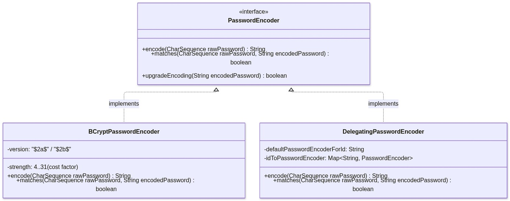

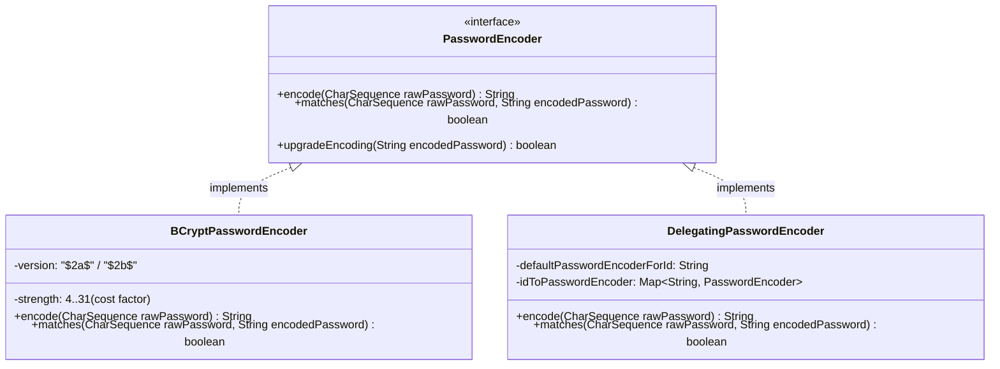

##### Cơ chế tiền tố thuật toán (Algorithm Prefix)

`DelegatingPasswordEncoder` sử dụng cơ chế tiền tố định danh dạng `{id}` ở đầu chuỗi hash để xác định thuật toán đã dùng để băm:

- BCrypt: `{bcrypt}$2a$10$e0MYzXyjpJS7Pd0RVvHwHe...`

- Argon2: `{argon2}$v=19$m=16384,t=2,p=1$...`

- PBKDF2: `{pbkdf2}$...`

**Ý nghĩa kiến trúc:**
Khi hệ thống InstaClone hoạt động qua nhiều năm và muốn nâng cấp thuật toán từ BCrypt sang Argon2 (thuật toán chống lại việc bẻ khóa bằng chip ASIC và GPU nhờ cơ chế Memory-Hard), ta chỉ cần đổi `defaultPasswordEncoderForId` sang Argon2. Khi người dùng cũ đăng nhập, `DelegatingPasswordEncoder` sẽ đọc prefix `{bcrypt}`, dùng `BCryptPasswordEncoder` để kiểm tra `matches()`. Nếu mật khẩu đúng, hàm `upgradeEncoding()` trả về `true`, hệ thống lập tức băm lại mật khẩu bằng Argon2 mới và cập nhật ngược vào database mà người dùng không hề bị gián đoạn hay bắt buộc phải đặt lại mật khẩu.

#### 2.3. Cấu trúc nội tại của chuỗi băm BCrypt

Một chuỗi băm BCrypt chuẩn mực có độ dài 60 ký tự, cấu trúc thành 4 phần riêng biệt:

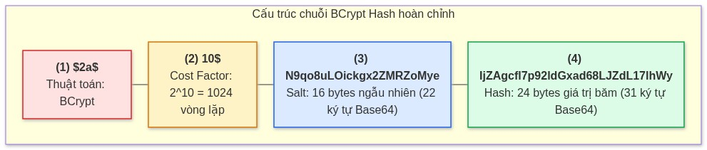

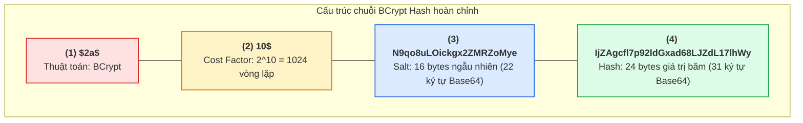

1. `$2a$`: Định danh phiên bản thuật toán BCrypt.
2. `10$`: Cost factor (Work factor) ở mức $2^{10} = 1024$ vòng lặp tính toán.
3. `N9qo8uLOickgx2ZMRZoMye`: 22 ký tự biểu diễn chuỗi **Salt** (16 bytes sinh ngẫu nhiên được mã hóa Radix-64).
4. `IjZAgcfl7p92ldGxad68LJZdL17lhWy`: 31 ký tự biểu diễn kết quả băm mã hóa cuối cùng.

Khi gọi hàm `passwordEncoder.matches(rawPassword, encodedPassword)`:

1. Thuật toán tự động trích xuất chuỗi Salt (phần 3) và Cost Factor (phần 2) trực tiếp từ `encodedPassword`.

2. Thuật toán lấy `rawPassword` người dùng vừa nhập, băm lại với đúng chuỗi Salt và Cost Factor vừa trích xuất.

3. So sánh chuỗi hash vừa tạo với phần băm cũ (phần 4) bằng thuật toán so sánh chuỗi có thời gian cố định (**Constant-time comparison**) nhằm chống tấn công phân tích thời gian thực thi (Timing Attack).

---

### 3. MINH HỌA CODE CHUẨN MỰC TRÊN INSTACLONE

Dưới đây là mã nguồn cấu hình mã hóa mật khẩu và API đăng ký tài khoản cho InstaClone sử dụng Java 21, Spring Boot 4.x và Spring Data JPA.

#### 3.1. Cấu hình Bean `PasswordEncoder`

```java
package com.instaclone.infrastructure.security.config;

import org.springframework.context.annotation.Bean;
import org.springframework.context.annotation.Configuration;
import org.springframework.security.crypto.factory.PasswordEncoderFactories;
import org.springframework.security.crypto.password.PasswordEncoder;

@Configuration
public class PasswordEncoderConfig {

    /**
     * Tạo Bean PasswordEncoder mặc định của Spring Security (DelegatingPasswordEncoder).
     * Mặc định sử dụng BCrypt với prefix {bcrypt}, tự động hỗ trợ tương thích ngược
     * và nâng cấp thuật toán mã hóa trong tương lai mà không làm gián đoạn hệ thống.
     */
    @Bean
    public PasswordEncoder passwordEncoder() {
        return PasswordEncoderFactories.createDelegatingPasswordEncoder();
    }
}

```

#### 3.2. DTO Đăng ký tài khoản

```java
package com.instaclone.application.dto.request;

import jakarta.validation.constraints.Email;
import jakarta.validation.constraints.NotBlank;
import jakarta.validation.constraints.Size;

public record RegisterRequest(
    @NotBlank(message = "Username cannot be blank")
    @Size(min = 3, max = 50, message = "Username must be between 3 and 50 characters")
    String username,

    @NotBlank(message = "Password cannot be blank")
    @Size(min = 8, max = 100, message = "Password must have at least 8 characters")
    String password,

    @NotBlank(message = "Email cannot be blank")
    @Email(message = "Email must be a valid email format")
    String email
) {}

```

#### 3.3. DTO Phản hồi thông tin người dùng

```java
package com.instaclone.application.dto.response;

import java.util.Set;

public record UserProfileResponse(
    Long id,
    String username,
    String email,
    Set<String> roles
) {}

```

#### 3.4. Triển khai Service Đăng ký tài khoản và Mã hóa

```java
package com.instaclone.application.service;

import com.instaclone.application.dto.request.RegisterRequest;
import com.instaclone.application.dto.response.UserProfileResponse;
import com.instaclone.domain.entity.User;
import com.instaclone.domain.repository.UserRepository;
import org.slf4j.Logger;
import org.slf4j.LoggerFactory;
import org.springframework.security.crypto.password.PasswordEncoder;
import org.springframework.stereotype.Service;
import org.springframework.transaction.annotation.Transactional;

import java.util.Set;

@Service
public class UserService {

    private static final Logger log = LoggerFactory.getLogger(UserService.class);

    private final UserRepository userRepository;
    private final PasswordEncoder passwordEncoder;

    public UserService(UserRepository userRepository, PasswordEncoder passwordEncoder) {
        this.userRepository = userRepository;
        this.passwordEncoder = passwordEncoder;
    }

    @Transactional
    public UserProfileResponse registerUser(RegisterRequest request) {
        if (userRepository.existsByUsername(request.username())) {
            throw new IllegalArgumentException("Username already taken: " + request.username());
        }
        if (userRepository.existsByEmail(request.email())) {
            throw new IllegalArgumentException("Email already in use: " + request.email());
        }

        // BẮT BUỘC: Mã hóa mật khẩu thông qua DelegatingPasswordEncoder trước khi lưu
        String encodedPassword = passwordEncoder.encode(request.password());
        log.debug("Encoded password generated with prefix for user: {}", request.username());

        User newUser = new User(
            request.username(),
            encodedPassword,
            request.email(),
            Set.of("ROLE_USER")
        );

        User savedUser = userRepository.save(newUser);

        return new UserProfileResponse(
            savedUser.getId(),
            savedUser.getUsername(),
            savedUser.getEmail(),
            savedUser.getRoles()
        );
    }
}

```

#### 3.5. REST Controller Tiếp nhận Đăng ký

```java
package com.instaclone.presentation.controller;

import com.instaclone.application.dto.request.RegisterRequest;
import com.instaclone.application.dto.response.UserProfileResponse;
import com.instaclone.application.service.UserService;
import jakarta.validation.Valid;
import org.springframework.http.HttpStatus;
import org.springframework.http.ResponseEntity;
import org.springframework.web.bind.annotation.PostMapping;
import org.springframework.web.bind.annotation.RequestBody;
import org.springframework.web.bind.annotation.RequestMapping;
import org.springframework.web.bind.annotation.RestController;

@RestController
@RequestMapping("/api/v1/auth")
public class AuthRegistrationController {

    private final UserService userService;

    public AuthRegistrationController(UserService userService) {
        this.userService = userService;
    }

    @PostMapping("/register")
    public ResponseEntity<UserProfileResponse> register(@Valid @RequestBody RegisterRequest request) {
        UserProfileResponse response = userService.registerUser(request);
        return ResponseEntity.status(HttpStatus.CREATED).body(response);
    }
}

```

---

### 4. BẪY LỖI KINH ĐIỂN & RỦI RO BẢO MẬT (GOTCHAS & PITFALLS)

- **Bẫy 1: Ngoại lệ `IllegalArgumentException: There is no PasswordEncoder mapped for the id "null"**`

- _Hiện tượng:_ Người dùng không thể đăng nhập và hệ thống ném ra lỗi trên khi gọi hàm `matches()`.

- _Nguyên nhân:_ Database chứa dữ liệu mật khẩu cũ được lưu dưới dạng Plaintext hoặc chuỗi hash không có tiền tố `{id}` (ví dụ: `$2a$10$...` thay vì `{bcrypt}$2a$10$...`). Khi `DelegatingPasswordEncoder` đọc chuỗi hash, nó tìm kiếm tiền tố nằm giữa cặp dấu `{}`. Nếu không tìm thấy, id sẽ là `null` và hệ thống từ chối xử lý để đảm bảo an toàn.

- _Cách khắc phục:_ Viết một migration script (Flyway/Liquibase) để bổ sung tiền tố `{bcrypt}` vào trước toàn bộ chuỗi hash hiện có, hoặc cấu hình `setDefaultPasswordEncoderForMatches(new BCryptPasswordEncoder())` trên `DelegatingPasswordEncoder` để xử lý chuỗi không có tiền tố.

- **Bẫy 2: Mã hóa mật khẩu nhiều lần (Double Encoding)**
- _Hiện tượng:_ Người dùng đăng ký thành công nhưng không bao giờ đăng nhập được với mật khẩu vừa tạo; hàm `matches()` luôn trả về `false`.
- _Nguyên nhân:_ Lập trình viên gọi `passwordEncoder.encode()` ở tầng Controller hoặc DTO Mapper, sau đó ở tầng Service lại tiếp tục gọi `passwordEncoder.encode()` một lần nữa trên chuỗi đã bị mã hóa.
- _Cách khắc phục:_ Duy trì quy tắc kiến trúc duy nhất: Việc mã hóa mật khẩu chỉ được diễn ra **duy nhất một lần** tại ranh giới tầng Business Service ngay trước khi gắn vào Entity.

- **Bẫy 3: Đặt Cost Factor quá cao làm nghẽn CPU (Denial of Service tự gây ra)**
- _Hiện tượng:_ Server bị treo cứng hoặc tăng vọt mức tiêu thụ CPU lên 100% khi chỉ có vài chục người dùng đăng nhập đồng thời.
- _Nguyên nhân:_ Lập trình viên cấu hình Cost Factor của BCrypt lên mức quá cao (ví dụ: 16 hoặc 18). Do cơ chế hàm số mũ $2^{strength}$, mức 16 mất khoảng 3–5 giây tính toán cho mỗi request mã hóa trên một CPU core.
- _Cách khắc phục:_ Benchmark trực tiếp trên máy chủ Production để đảm bảo thời gian xử lý của mỗi phép băm nằm trong khoảng tối ưu: **100ms – 250ms** (thông thường mức `strength = 10` đến `12` là tối ưu cho hạ tầng hiện nay).

---

### 5. BỘ CÂU HỎI TƯ DUY & PHẢN BIỆN (DEEP-DIVE QUESTIONS)

1. _Khi triển khai tính năng cập nhật thông tin cá nhân của người dùng trên InstaClone, nếu người dùng chỉ cập nhật Bio và Email mà không đổi mật khẩu, điều gì sẽ xảy ra nếu Service vô tình lấy mật khẩu hiện tại trong database và gọi lại `passwordEncoder.encode(user.getPassword())` trước khi `save()`?_
2. _Tại sao việc kiểm tra mật khẩu bằng phương thức `password.equals(storedPassword)` lại dẫn đến lỗ hổng Side-Channel Timing Attack, và lớp `MessageDigest.isEqual()` trong Spring Security giải quyết bài toán này như thế nào?_

---

---

## CHƯƠNG 4: CƠ CHẾ XÁC THỰC (AUTHENTICATION FLOW) & SECURITY CONTEXT

### 1. ĐẶT VẤN ĐỀ & CÂU HỎI TRỌNG TÂM

#### Bài toán thực tế trên mạng xã hội InstaClone

Sau khi người dùng đã đăng ký tài khoản trên InstaClone, hệ thống cần xử lý yêu cầu đăng nhập gửi kèm JSON Payload chứa `username` và `password`. Nếu xác thực thành công, hệ thống cần ghi nhớ trạng thái của người dùng để ở các request kế tiếp (ví dụ: lấy thông tin cá nhân `GET /api/v1/users/me`), Backend biết chính xác ai đang thực hiện request mà không bắt buộc họ phải gửi lại mật khẩu.

Nhiều lập trình viên tự xử lý luồng này bằng cách:

1. Tự tiêm `UserRepository` vào `LoginController`, so sánh chuỗi mật khẩu thủ công.

2. Tự lưu thông tin người dùng vào một trường `static` hoặc tự tạo một biến trong `HttpSession`.

**Thảm họa kiến trúc và an ninh xảy ra:**

- **Ô nhiễm ngữ cảnh luồng (Thread-Safety & Race Conditions):** Nếu lưu thông tin vào biến tĩnh hoặc chia sẻ tài nguyên không đúng chuẩn, người dùng A có thể nhìn thấy dữ liệu riêng tư của người dùng B khi Web Server tái sử dụng Thread (Thread Pooling).
- **Mất tính thống nhất với hệ sinh thái Spring:** Tự xử lý xác thực khiến hệ thống tách rời hoàn toàn khỏi các bộ lọc chuẩn của Spring Security. Hậu quả là các tính năng như `SecurityContextHolder`, bảo vệ phân quyền phương thức `@PreAuthorize`, hoặc tự động ghi nhật ký kiểm toán (Audit Logging) không thể hoạt động.

- **Lỗ hổng dò quét tài khoản (Username Enumeration):** Khi xác thực thất bại, lập trình viên thường bắt ngoại lệ và trả về các thông báo chi tiết như: _"Tên đăng nhập không tồn tại"_ hoặc _"Mật khẩu không chính xác"_. Điều này tạo điều kiện cho kẻ tấn công dò quét được danh sách toàn bộ các tài khoản có thật trên InstaClone.

#### Câu hỏi tư duy trọng tâm

> _Từ khoảnh khắc người dùng bấm nút gửi payload đăng nhập cho tới khi `SecurityContextHolder` lưu trữ thành công thông tin Principal, request đã đi qua những trạm kiểm soát nào trong Spring Security 7.x? Tại sao Spring Security 7.x lại áp dụng cơ chế Explicit Save kết hợp Jackson 3 cho SecurityContext thay vì tự động lưu ngầm định như các phiên bản cũ?_

---

### 2. PHÂN TÍCH KIẾN TRÚC & CƠ CHẾ NỘI TẠI (UNDER THE HOOD)

#### 2.1. Các thực thể cốt lõi trong mô hình xác thực (Core Interfaces)

Hệ thống xác thực của Spring Security được xây dựng dựa trên các thành phần độc lập nhưng phối hợp chặt chẽ theo mẫu thiết kế **Chain of Responsibility** và **Strategy Pattern**:

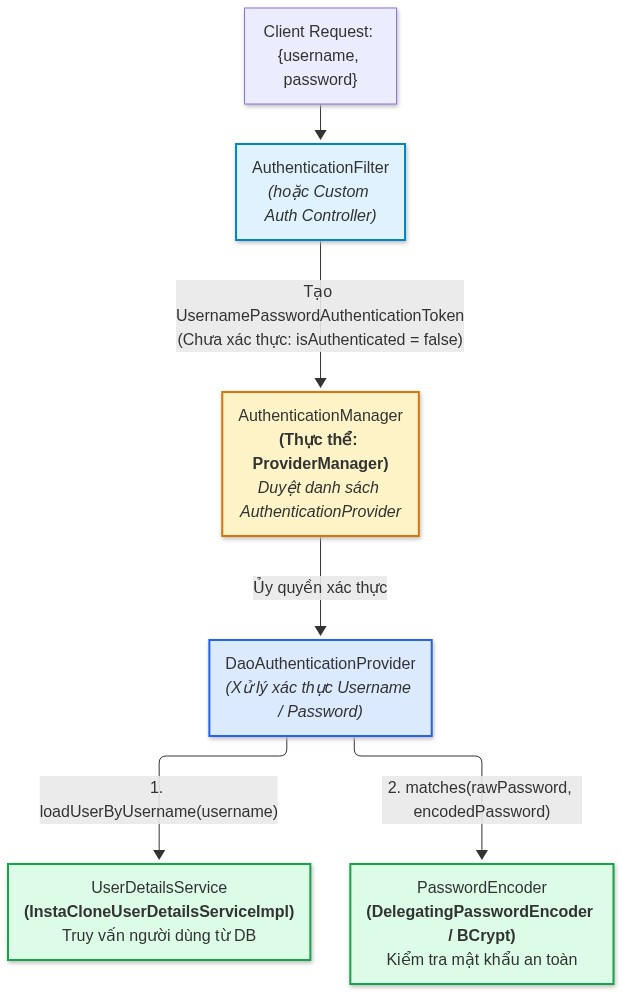

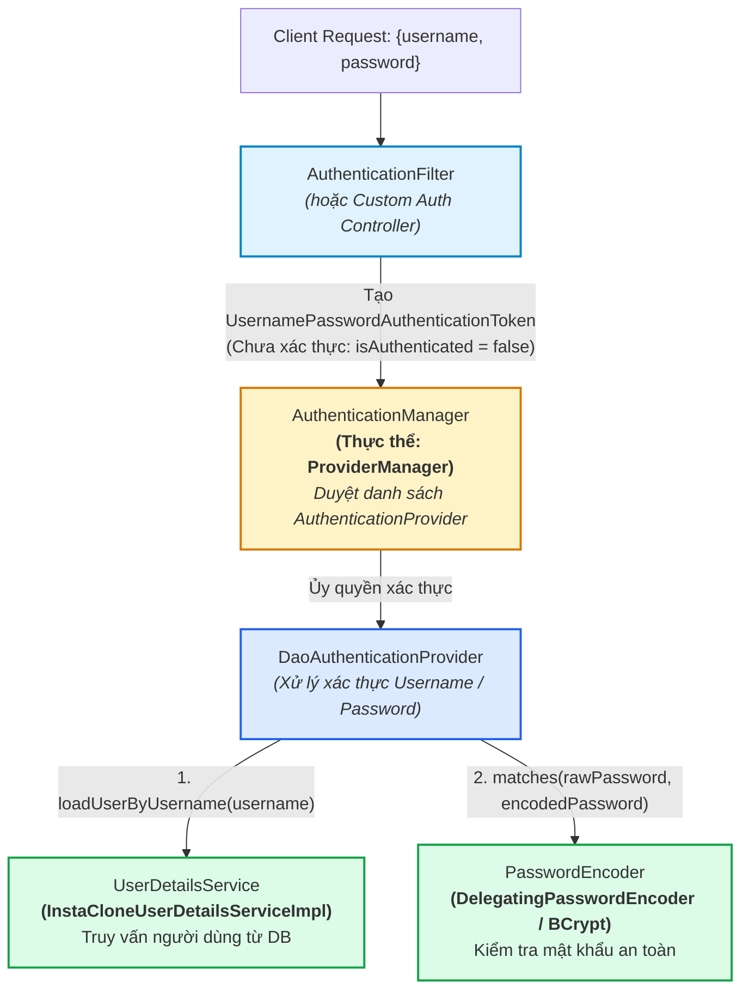

1. **`Authentication` (Interface):** Đại diện cho một yêu cầu xác thực hoặc một danh tính đã được xác thực. Gồm các phương thức cốt lõi:

- `getPrincipal()`: Trả về danh tính người dùng (thường là một thực thể `UserDetails` khi đã xác thực, hoặc chuỗi username khi chưa xác thực).

- `getCredentials()`: Trả về bằng chứng xác thực (ví dụ: chuỗi mật khẩu gốc; trường này thường bị xóa sạch ngay sau khi xác thực thành công để chống rò rỉ bộ nhớ).

- `getAuthorities()`: Danh sách các quyền hạn được cấp (`Collection<? extends GrantedAuthority>`).

- `isAuthenticated()`: Trạng thái cờ `boolean` xác nhận danh tính đã được xác minh thành công hay chưa.

2. **`AuthenticationManager` & `ProviderManager`:**

- `AuthenticationManager` là interface đầu não nhận một đối tượng `Authentication` chưa xác thực và trả về một `Authentication` đã xác thực hoàn toàn (kèm quyền hạn) hoặc ném ra `AuthenticationException`.

- `ProviderManager` là lớp triển khai mặc định của `AuthenticationManager`, chứa một danh sách `List<AuthenticationProvider>`. Nó lần lượt duyệt qua từng Provider xem lớp nào hỗ trợ (`supports()`) kiểu token hiện tại để xử lý.

3. **`DaoAuthenticationProvider`:**

- Là `AuthenticationProvider` mặc định chuyên xử lý cặp giá trị username/password.

- Trách nhiệm: Gọi `UserDetailsService.loadUserByUsername()` để nạp đối tượng `UserDetails` từ nguồn dữ liệu, sau đó gọi `PasswordEncoder.matches()` để so khớp mật khẩu.

4. **`UserDetailsService`:**

- Interface chỉ có duy nhất một phương thức: `UserDetails loadUserByUsername(String username) throws UsernameNotFoundException;`.

- Chỉ đóng vai trò là cầu nối truy xuất dữ liệu (Data Access Adapter), tuyệt đối **không** chứa logic so khớp mật khẩu hay phân quyền.

#### 2.2. Sơ đồ tuần tự quá trình xác thực (Sequence Diagram)

Dưới đây là luồng tương tác chi tiết khi một request đăng nhập được xử lý qua `DaoAuthenticationProvider`:

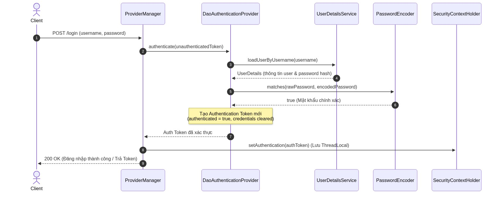

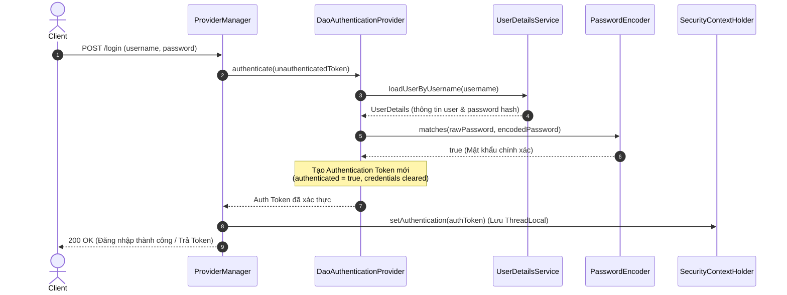

#### 2.3. Cơ chế Quản lý `SecurityContext` trong Spring Security 7.x

##### `SecurityContextHolder` và `ThreadLocal`

`SecurityContextHolder` là lớp tiện ích tĩnh dùng để truy cập `SecurityContext` hiện tại. Mặc định, nó sử dụng chiến lược `MODE_THREADLOCAL`, nghĩa là mỗi luồng (Thread) xử lý HTTP request trong Web Container sẽ sở hữu một bản sao `SecurityContext` độc lập gắn liền với vòng đời của luồng đó.

##### Sự thay đổi đột phá trong 7.x: `SecurityContextHolderFilter` & Explicit Save

- _Lịch sử:_ Ở các phiên bản Spring Security 5.x trở về trước, lớp `SecurityContextPersistenceFilter` hoạt động theo cơ chế ngầm định (Implicit Save). Bất kỳ thay đổi nào trên `SecurityContext` trong suốt vòng đời của request đều tự động được đồng bộ vào `HttpSession` khi request kết thúc. Điều này dẫn đến sự cố tranh chấp ghi (Race condition) và không tối ưu hóa tài nguyên cho kiến trúc bất đồng bộ hoặc RESTful.
- _Chuẩn Spring Security 7.x:_ Sử dụng **`SecurityContextHolderFilter`** kết hợp cơ chế **Explicit Save** (Lưu tường minh):

- `SecurityContext` **chỉ được lưu** vào `SecurityContextRepository` (ví dụ: Session hoặc Cache Store) khi và chỉ khi lập trình viên hoặc framework gọi tường minh phương thức `securityContextRepository.saveContext(context, request, response)`.

- Sau khi kết thúc chuỗi Filter, `SecurityContextHolderFilter` tự động dọn sạch ngữ cảnh bằng lệnh `SecurityContextHolder.clearContext()` để đảm bảo luồng (Thread) khi trả về Thread Pool không bị ô nhiễm dữ liệu của người dùng trước.

##### Tuần tự hóa phiên làm việc chuẩn Jackson 3

Trong Spring Framework 7 và Spring Security 7.x, toàn bộ các lớp đối tượng bảo mật liên quan đến phiên (`SecurityContext`, `User`, `OAuth2AuthenticationToken`) khi lưu trữ phân tán vào Redis/Session Store đều được tuần tự hóa thông qua bộ thư viện **Jackson 3** (Jakarta JSON Dataformats) thay cho Jackson 2 cũ, giúp cải thiện tốc độ serialize và ngăn ngừa triệt để các lỗ hổng thực thi mã từ xa (RCE Deserialization Attacks).

---

### 3. MINH HỌA CODE CHUẨN MỰC TRÊN INSTACLONE

Dưới đây là toàn bộ mã nguồn xử lý xác thực danh tính cho InstaClone trên nền tảng Java 21 và Spring Security 7.x.

#### 3.1. Cài đặt `UserDetails`: `InstaCloneUserDetails`

Thay vì để Entity `User` phụ thuộc trực tiếp vào các giao diện của Spring Security, ta tạo một lớp Adapter đóng gói danh tính người dùng:

```java
package com.instaclone.infrastructure.security.model;

import com.instaclone.domain.entity.User;
import org.springframework.security.core.GrantedAuthority;
import org.springframework.security.core.authority.SimpleGrantedAuthority;
import org.springframework.security.core.userdetails.UserDetails;

import java.util.Collection;
import java.util.stream.Collectors;

public class InstaCloneUserDetails implements UserDetails {

    private final Long id;
    private final String username;
    private final String password;
    private final String email;
    private final Collection<? extends GrantedAuthority> authorities;

    public InstaCloneUserDetails(User user) {
        this.id = user.getId();
        this.username = user.getUsername();
        this.password = user.getPassword();
        this.email = user.getEmail();
        this.authorities = user.getRoles().stream()
                .map(SimpleGrantedAuthority::new)
                .collect(Collectors.toUnmodifiableSet());
    }

    public Long getId() { return id; }
    public String getEmail() { return email; }

    @Override
    public Collection<? extends GrantedAuthority> getAuthorities() {
        return authorities;
    }

    @Override
    public String getPassword() {
        return password;
    }

    @Override
    public String getUsername() {
        return username;
    }

    @Override
    public boolean isAccountNonExpired() { return true; }

    @Override
    public boolean isAccountNonLocked() { return true; }

    @Override
    public boolean isCredentialsNonExpired() { return true; }

    @Override
    public boolean isEnabled() { return true; }
}

```

#### 3.2. Cài đặt `UserDetailsService`: `InstaCloneUserDetailsService`

```java
package com.instaclone.infrastructure.security.service;

import com.instaclone.domain.entity.User;
import com.instaclone.domain.repository.UserRepository;
import com.instaclone.infrastructure.security.model.InstaCloneUserDetails;
import org.springframework.security.core.userdetails.UserDetails;
import org.springframework.security.core.userdetails.UserDetailsService;
import org.springframework.security.core.userdetails.UsernameNotFoundException;
import org.springframework.stereotype.Service;
import org.springframework.transaction.annotation.Transactional;

@Service
public class InstaCloneUserDetailsService implements UserDetailsService {

    private final UserRepository userRepository;

    public InstaCloneUserDetailsService(UserRepository userRepository) {
        this.userRepository = userRepository;
    }

    @Override
    @Transactional(readOnly = true)
    public UserDetails loadUserByUsername(String username) throws UsernameNotFoundException {
        User user = userRepository.findByUsername(username)
                .orElseThrow(() -> new UsernameNotFoundException("User not found with username: " + username));

        return new InstaCloneUserDetails(user);
    }
}

```

#### 3.3. Cấu hình Xuất bản Bean `AuthenticationManager`

Trong Spring Security 7.x, để có thể tiêm `AuthenticationManager` vào Controller hoặc Service, ta xuất bản thông qua cấu hình chuẩn của `AuthenticationConfiguration`:

```java
package com.instaclone.infrastructure.security.config;

import org.springframework.context.annotation.Bean;
import org.springframework.context.annotation.Configuration;
import org.springframework.security.authentication.AuthenticationManager;
import org.springframework.security.config.annotation.authentication.configuration.AuthenticationConfiguration;

@Configuration
public class AuthenticationManagerConfig {

    @Bean
    public AuthenticationManager authenticationManager(AuthenticationConfiguration config) throws Exception {
        return config.getAuthenticationManager();
    }
}

```

#### 3.4. DTO Yêu cầu Đăng nhập

```java
package com.instaclone.application.dto.request;

import jakarta.validation.constraints.NotBlank;

public record LoginRequest(
    @NotBlank(message = "Username cannot be blank")
    String username,

    @NotBlank(message = "Password cannot be blank")
    String password
) {}

```

#### 3.5. Triển khai API Đăng nhập với Explicit Save chuẩn 7.x

Đoạn code dưới đây xử lý đăng nhập, bắt các lỗi xác thực để ngăn chặn việc rò rỉ danh tính (Username Enumeration) và thực thi cơ chế Explicit Save cho `SecurityContext`:

```java
package com.instaclone.presentation.controller;

import com.instaclone.application.dto.request.LoginRequest;
import com.instaclone.application.dto.response.UserProfileResponse;
import com.instaclone.infrastructure.security.model.InstaCloneUserDetails;
import jakarta.servlet.http.HttpServletRequest;
import jakarta.servlet.http.HttpServletResponse;
import jakarta.validation.Valid;
import org.slf4j.Logger;
import org.slf4j.LoggerFactory;
import org.springframework.http.HttpStatus;
import org.springframework.http.ResponseEntity;
import org.springframework.security.authentication.AuthenticationManager;
import org.springframework.security.authentication.BadCredentialsException;
import org.springframework.security.authentication.DisabledException;
import org.springframework.security.authentication.LockedException;
import org.springframework.security.authentication.UsernamePasswordAuthenticationToken;
import org.springframework.security.core.Authentication;
import org.springframework.security.core.AuthenticationException;
import org.springframework.security.core.context.SecurityContext;
import org.springframework.security.core.context.SecurityContextHolder;
import org.springframework.security.core.context.SecurityContextHolderStrategy;
import org.springframework.security.web.context.HttpSessionSecurityContextRepository;
import org.springframework.security.web.context.SecurityContextRepository;
import org.springframework.web.bind.annotation.*;

import java.util.Map;
import java.util.stream.Collectors;

@RestController
@RequestMapping("/api/v1/auth")
public class AuthenticationController {

    private static final Logger log = LoggerFactory.getLogger(AuthenticationController.class);

    private final AuthenticationManager authenticationManager;
    private final SecurityContextHolderStrategy securityContextHolderStrategy =
            SecurityContextHolder.getContextHolderStrategy();
    private final SecurityContextRepository securityContextRepository =
            new HttpSessionSecurityContextRepository();

    public AuthenticationController(AuthenticationManager authenticationManager) {
        this.authenticationManager = authenticationManager;
    }

    @PostMapping("/login")
    public ResponseEntity<?> login(@Valid @RequestBody LoginRequest request,
                                   HttpServletRequest httpRequest,
                                   HttpServletResponse httpResponse) {
        try {
            // 1. Tạo Authentication Token chưa xác thực từ dữ liệu đăng nhập
            UsernamePasswordAuthenticationToken unauthenticatedToken =
                    UsernamePasswordAuthenticationToken.unauthenticated(request.username(), request.password());

            // 2. Kích hoạt AuthenticationManager để thực thi toàn bộ chuỗi DaoAuthenticationProvider
            Authentication authentication = authenticationManager.authenticate(unauthenticatedToken);

            // 3. Khởi tạo SecurityContext mới và thiết lập Authentication thành công
            SecurityContext context = securityContextHolderStrategy.createEmptyContext();
            context.setAuthentication(authentication);
            securityContextHolderStrategy.setContext(context);

            // 4. CHUẨN 7.x EXPLICIT SAVE: Bắt buộc lưu tường minh Context vào Repository (Session)
            securityContextRepository.saveContext(context, httpRequest, httpResponse);

            log.info("User logged in successfully: {}", request.username());
            return ResponseEntity.ok(Map.of("message", "Login successful"));

        } catch (BadCredentialsException | DisabledException | LockedException ex) {
            // AN NINH: Luôn trả về thông báo chung để ngăn chặn lỗ hổng Username Enumeration
            log.warn("Authentication failed for username '{}': {}", request.username(), ex.getMessage());
            return ResponseEntity.status(HttpStatus.UNAUTHORIZED).body(Map.of(
                "error", "Unauthorized",
                "message", "Invalid username or password"
            ));
        } catch (AuthenticationException ex) {
            log.error("System authentication error: {}", ex.getMessage());
            return ResponseEntity.status(HttpStatus.UNAUTHORIZED).body(Map.of(
                "error", "Unauthorized",
                "message", "Authentication process failed"
            ));
        }
    }

    /**
     * API kiểm tra thông tin người dùng hiện tại từ SecurityContextHolder
     */
    @GetMapping("/me")
    public ResponseEntity<?> getCurrentUser(Authentication authentication) {
        if (authentication == null || !(authentication.getPrincipal() instanceof InstaCloneUserDetails userDetails)) {
            return ResponseEntity.status(HttpStatus.UNAUTHORIZED).body(Map.of("error", "Not authenticated"));
        }

        UserProfileResponse response = new UserProfileResponse(
            userDetails.getId(),
            userDetails.getUsername(),
            userDetails.getEmail(),
            userDetails.getAuthorities().stream().map(a -> a.getAuthority()).collect(Collectors.toSet())
        );

        return ResponseEntity.ok(response);
    }
}

```

---

### 4. BẪY LỖI KINH ĐIỂN & RỦI RO BẢO MẬT (GOTCHAS & PITFALLS)

- **Bẫy 1: Quên cơ chế Explicit Save trong Spring Security 7.x khiến Request kế tiếp bị 401**

- _Hiện tượng:_ Gọi API `/api/v1/auth/login` báo đăng nhập thành công (`200 OK`), nhưng ngay lập tức gọi API `/api/v1/auth/me` thì bị lỗi `401 Unauthorized`.

- _Nguyên nhân:_ Lập trình viên thiết lập `SecurityContextHolder.getContext().setAuthentication(auth)` nhưng **quên không gọi** `securityContextRepository.saveContext(context, request, response)`. Trong Spring Security 7.x với cơ chế Explicit Save, nếu không gọi lệnh lưu tường minh này, SecurityContext sẽ bị hủy khi luồng kết thúc và không bao giờ được ghi vào `HttpSession`.

- _Cách khắc phục:_ Luôn tiêm `SecurityContextRepository` và gọi hàm `saveContext()` sau khi cập nhật danh tính người dùng trong các Custom Auth Controller.

- **Bẫy 2: Lỗ hổng dò quét tài khoản (Username Enumeration) qua ngoại lệ**

- _Hiện tượng:_ Khi đăng nhập với tên người dùng không tồn tại thì hệ thống trả về: _"Tài khoản không tồn tại"_, còn khi nhập đúng tài khoản nhưng sai mật khẩu thì hệ thống trả về: _"Mật khẩu không chính xác"_.

- _Nguyên nhân:_ Bắt trực tiếp ngoại lệ `UsernameNotFoundException` và trả về chi tiết thông điệp lỗi cho Client. Mặc định trong `DaoAuthenticationProvider`, Spring Security đã chủ động thiết lập cờ `hideUserNotFoundExceptions = true` (chuyển đổi `UsernameNotFoundException` thành `BadCredentialsException`) để bảo vệ hệ thống. Tuy nhiên, nếu lập trình viên tự viết logic trong Controller mà bóc tách chi tiết hai thông điệp này, hệ thống sẽ bị lộ danh sách người dùng cho tin tặc khai thác.

- _Cách khắc phục:_ Luôn gom tất cả lỗi xác thực liên quan đến định danh/mật khẩu thành một thông điệp đồng nhất: _"Invalid username or password"_.

- **Bẫy 3: Mất thông tin xác thực khi xử lý tác vụ bất đồng bộ (`@Async`)**

- _Hiện tượng:_ Trong luồng xử lý chính, người dùng đã đăng nhập, nhưng khi gọi sang một phương thức gắn `@Async` (ví dụ: tạo thumbnail ảnh bài đăng trong background) thì `SecurityContextHolder.getContext().getAuthentication()` trả về `null`.

- _Nguyên nhân:_ `SecurityContextHolder` mặc định sử dụng `ThreadLocal`. Khi một phương thức chạy bất đồng bộ qua `@Async`, nó được thực thi trên một Thread hoàn toàn mới từ Thread Pool khác, luồng này không có bản sao dữ liệu của luồng chính.

- _Cách khắc phục:_ Cấu hình `DelegatingSecurityContextAsyncTaskExecutor` cho bộ điều phối luồng `TaskExecutor`, hoặc cấu hình `SecurityContextHolder.setStrategyName(SecurityContextHolder.MODE_INHERITABLETHREADLOCAL)` cho các môi trường phù hợp.

---

### 5. BỘ CÂU HỎI TƯ DUY & PHẢN BIỆN (DEEP-DIVE QUESTIONS)

1. _Tại sao phương thức `loadUserByUsername()` trong `UserDetailsService` chỉ nhận một tham số duy nhất là `String username` mà không nhận mật khẩu? Về mặt phân tách trách nhiệm kiến trúc, tại sao việc so sánh mật khẩu lại thuộc về `AuthenticationProvider` chứ không phải `UserDetailsService`?_

2. _Khi người dùng hoàn tất đăng nhập thành công trên InstaClone, thuộc tính `credentials` (mật khẩu gốc) trong đối tượng `Authentication` được xử lý như thế nào trước khi lưu vào `SecurityContextHolder`? Việc giữ lại `credentials` trong bộ nhớ ứng dụng tiềm ẩn những rủi ro bảo mật nào?_

---

## CHƯƠNG 5: PHÂN QUYỀN ĐA TẦNG VỚI AUTHORIZATIONMANAGER & CHỐNG BOLA/IDOR

### 1. ĐẶT VẤN ĐỀ & CÂU HỎI TRỌNG TÂM

#### Bài toán thực tế trên mạng xã hội InstaClone

Sau khi hoàn thiện cơ chế xác thực danh tính ở Chương 4, hệ thống InstaClone đối mặt với một vấn đề nhức nhối: **Xác thực thành công không đồng nghĩa với việc có quyền thực hiện thao tác**.

Xét tình huống nghiệp vụ:

- Người dùng Bob (`ROLE_USER`) đăng nhập thành công vào InstaClone.

- Alice (`ROLE_USER`) sở hữu một bài đăng riêng tư (`Post` có ID `105`, chế độ `PRIVATE`).

- Bob mở công cụ Network trên trình duyệt hoặc Postman, gửi request:
  `DELETE /api/v1/posts/105` hoặc `GET /api/v1/posts/105`

Nếu hệ thống chỉ dựa vào phân quyền thô ở mức URL (Request-level) theo kiểu:

```java
.requestMatchers(HttpMethod.DELETE, "/api/v1/posts/**").hasRole("USER")

```

Lúc này, Spring Security kiểm tra thấy Bob có `ROLE_USER` nên cho phép request đi qua. Nếu tầng Service chỉ thực thi lệnh xóa đơn giản `postRepository.deleteById(105L)` mà không kiểm tra quyền sở hữu, Bob đã xóa sổ hoàn toàn dữ liệu của Alice!

Đây chính là lỗ hổng bảo mật xếp vị trí số 1 trong OWASP API Security Top 10: **BOLA (Broken Object Level Authorization)**, hay còn gọi là **IDOR (Insecure Direct Object References)**.

#### Câu hỏi tư duy trọng tâm

> _Tại sao cơ chế phân quyền đường dẫn HTTP (Request-level Authorization) không bao giờ đủ để bảo vệ an toàn cho các ứng dụng định hướng dữ liệu (Data-driven Applications)? Kiến trúc `AuthorizationManager` trong Spring Security 7.x kết hợp cùng Spring AOP giải quyết bài toán phân quyền hạt mịn (Domain Object Security) như thế nào để triệt tiêu tận gốc lỗ hổng BOLA/IDOR?_

---

### 2. PHÂN TÍCH KIẾN TRÚC & CƠ CHẾ NỘI TẠI (UNDER THE HOOD)

#### 2.1. Sự thay đổi đột phá trong Spring Security 7.x: Xóa bỏ AccessDecisionManager

Trong các thế hệ trước (Spring Security 5.x trở về trước), việc phân quyền dựa trên một kiến trúc cồng kềnh gồm ba thành phần:

- `FilterSecurityInterceptor`
- `AccessDecisionManager` (với các chiến lược biểu quyết: `AffirmativeBased`, `ConsensusBased`, `UnanimousBased`)
- `AccessDecisionVoter`

Hệ thống cũ này sử dụng cơ chế biểu quyết phiếu bầu (Voting mechanism) rất phức tạp, khó mở rộng và tiêu tốn hiệu năng.

**Kiến trúc thống nhất trong Spring Security 7.x:**
Toàn bộ `AccessDecisionManager`, `AccessDecisionVoter` và `FilterSecurityInterceptor` đã **bị xóa bỏ hoàn toàn**. Mọi quyết định phân quyền từ mức URL đến Method đều được quy chuẩn hóa về giao diện duy nhất: **`AuthorizationManager<T>`**.

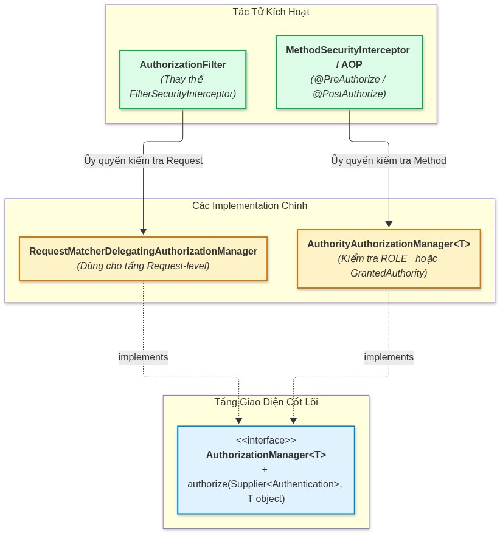

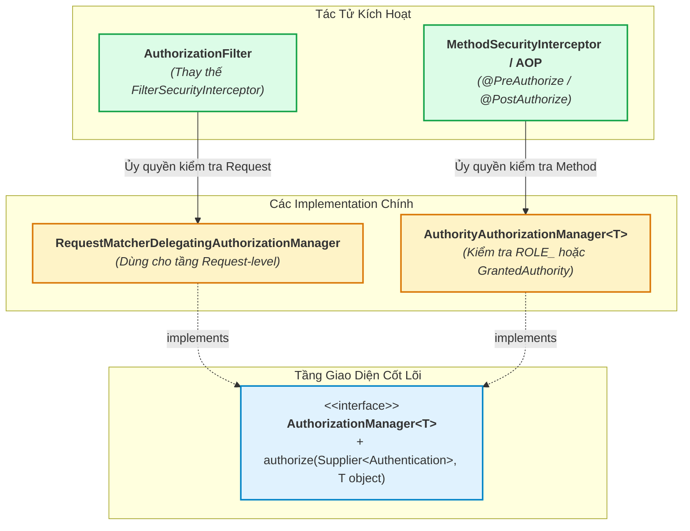

Phương thức cốt lõi duy nhất:

```java
AuthorizationDecision authorize(Supplier<Authentication> authentication, T object);

```

_(Lưu ý kiến trúc: Phương thức `check()` cũ đã bị loại bỏ hoàn toàn trong bản 7.0; mọi quyết định kiểm tra đều trả về đối tượng `AuthorizationDecision` chứa cờ `isGranted()`)_.

#### 2.2. Phân định bản chất: `hasRole` vs `hasAuthority`

Một nhầm lẫn kinh điển của lập trình viên là sử dụng lẫn lộn hai khái niệm này:

- **`hasAuthority("STRING")`**: So khớp chính xác chuỗi ký tự nguyên bản trong danh sách `GrantedAuthority` của Principal. Ví dụ: `hasAuthority("POST_DELETE")` chỉ cấp quyền nếu User có đúng quyền `POST_DELETE`.

- **`hasRole("STRING")`**: Tự động chèn thêm tiền tố **`ROLE_`** vào trước chuỗi cần kiểm tra. Khi khai báo `hasRole("ADMIN")`, Spring Security sẽ đối chiếu xem User có quyền `ROLE_ADMIN` hay không. Nếu trong database lưu `ADMIN` mà dùng `hasRole("ADMIN")`, hệ thống sẽ từ chối truy cập!

#### 2.3. Cơ chế Phân quyền Phương thức (Method Security) qua Spring AOP Proxy

Để giải quyết triệt để BOLA/IDOR, quyết định phân quyền phải được dời vào tầng Service nơi nắm giữ ngữ cảnh dữ liệu của Domain Entity. Spring Security sử dụng **Spring AOP (Aspect-Oriented Programming)** với annotation `@EnableMethodSecurity`.

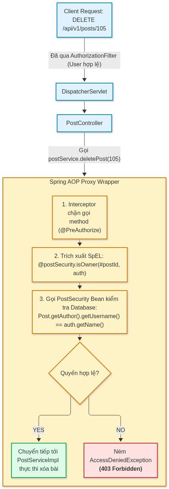

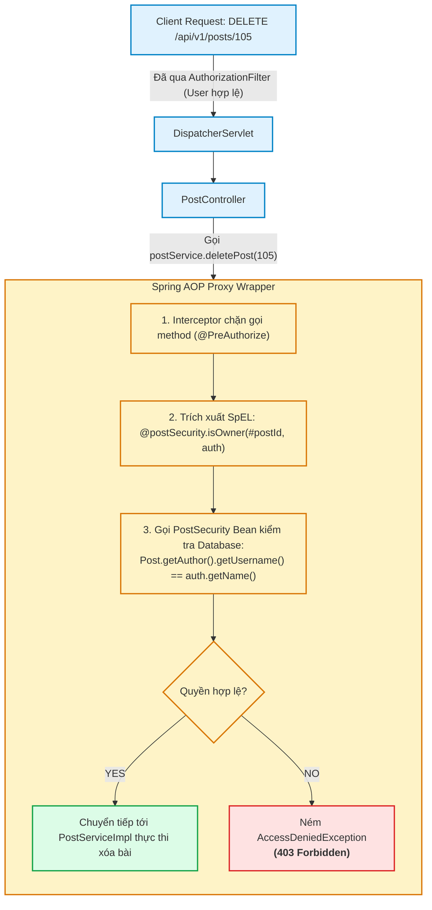

##### SpEL Operation Tracing trong Spring Framework 7

Trong Spring Framework 7 và Spring Security 7.x, các biểu thức SpEL (Spring Expression Language) bên trong `@PreAuthorize` và `@PostAuthorize` được hỗ trợ tính năng **SpEL Operation Tracing**, cho phép ghi log chi tiết từng nhánh tính toán logic (ví dụ: đánh giá biểu thức `isOwner` ra `true` hay `hasRole` ra `false`), giúp việc kiểm toán bảo mật và debug trở nên trực quan.

---

### 3. MINH HỌA CODE CHUẨN MỰC TRÊN INSTACLONE

Dưới đây là kiến trúc phân quyền đa tầng hoàn chỉnh cho InstaClone, kết hợp phân quyền URL và phân quyền dữ liệu chống BOLA/IDOR.

#### 3.1. Kích hoạt Method Security chuẩn 7.x

```java
package com.instaclone.infrastructure.security.config;

import org.springframework.context.annotation.Configuration;
import org.springframework.security.config.annotation.method.configuration.EnableMethodSecurity;

@Configuration
@EnableMethodSecurity(prePostEnabled = true) // Kích hoạt @PreAuthorize, @PostAuthorize chuẩn 7.x
public class MethodSecurityConfig {
    // Spring Security 7.x tự động đăng ký các AuthorizationManager trước/sau phương thức
}

```

#### 3.2. Cấu hình Phân quyền URL (Request-level)

```java
package com.instaclone.infrastructure.security.config;

import org.springframework.context.annotation.Bean;
import org.springframework.context.annotation.Configuration;
import org.springframework.http.HttpMethod;
import org.springframework.security.config.Customizer;
import org.springframework.security.config.annotation.web.builders.HttpSecurity;
import org.springframework.security.web.SecurityFilterChain;

@Configuration
public class SecurityRoutingConfig {

    @Bean
    public SecurityFilterChain securityFilterChain(HttpSecurity http) throws Exception {
        http
            .authorizeHttpRequests(authorize -> authorize
                // 1. Endpoint mở hoàn toàn cho bảng tin công khai
                .requestMatchers(HttpMethod.GET, "/api/v1/feed/public/**").permitAll()

                // 2. Endpoint chỉ dành cho Ban kiểm duyệt và Quản trị viên
                .requestMatchers("/api/v1/moderation/**").hasAnyRole("MODERATOR", "ADMIN")

                // 3. Endpoint bài đăng yêu cầu phải đăng nhập (Bảo vệ tầng 1)
                .requestMatchers("/api/v1/posts/**").authenticated()

                // 4. Khóa tất cả các đường dẫn còn lại
                .anyRequest().authenticated()
            )
            .httpBasic(Customizer.withDefaults());

        return http.build();
    }
}

```

#### 3.3. Lớp Thẩm định Quyền Sở hữu Tài nguyên: `PostSecurityEvaluator` (Chống BOLA)

```java
package com.instaclone.infrastructure.security.evaluator;

import com.instaclone.domain.entity.Post;
import com.instaclone.domain.repository.PostRepository;
import org.slf4j.Logger;
import org.slf4j.LoggerFactory;
import org.springframework.security.core.Authentication;
import org.springframework.stereotype.Component;
import org.springframework.transaction.annotation.Transactional;

@Component("postSecurity")
public class PostSecurityEvaluator {

    private static final Logger log = LoggerFactory.getLogger(PostSecurityEvaluator.class);
    private final PostRepository postRepository;

    public PostSecurityEvaluator(PostRepository postRepository) {
        this.postRepository = postRepository;
    }

    /**
     * Kiểm tra người dùng hiện tại có phải là tác giả của bài viết hay không.
     * Được gọi trực tiếp từ SpEL: @postSecurity.isOwner(#postId, authentication)
     */
    @Transactional(readOnly = true)
    public boolean isOwner(Long postId, Authentication authentication) {
        if (authentication == null || !authentication.isAuthenticated()) {
            return false;
        }

        String currentUsername = authentication.getName();
        Post post = postRepository.findById(postId).orElse(null);

        if (post == null) {
            // Không tìm thấy bài viết -> trả về true để Service xử lý ném lỗi 404 thay vì 403
            return true;
        }

        boolean isAuthor = post.getAuthor().getUsername().equals(currentUsername);
        log.debug("Checking ownership for post {}: user={}, isAuthor={}", postId, currentUsername, isAuthor);
        return isAuthor;
    }
}

```

#### 3.4. Tầng Dịch vụ Áp dụng `@PreAuthorize` và `@PostAuthorize`

```java
package com.instaclone.application.service;

import com.instaclone.domain.entity.Post;
import com.instaclone.domain.repository.PostRepository;
import org.springframework.security.access.prepost.PostAuthorize;
import org.springframework.security.access.prepost.PreAuthorize;
import org.springframework.stereotype.Service;
import org.springframework.transaction.annotation.Transactional;

@Service
public class PostService {

    private final PostRepository postRepository;

    public PostService(PostRepository postRepository) {
        this.postRepository = postRepository;
    }

    /**
     * CHỐNG BOLA/IDOR KHI XÓA:
     * Chỉ chủ sở hữu bài đăng HOẶC người có quyền MODERATOR mới được phép xóa.
     */
    @PreAuthorize("@postSecurity.isOwner(#postId, authentication) or hasRole('MODERATOR')")
    @Transactional
    public void deletePost(Long postId) {
        Post post = postRepository.findById(postId)
                .orElseThrow(() -> new IllegalArgumentException("Post not found: " + postId));
        postRepository.delete(post);
    }

    /**
     * BẢO VỆ DỮ LIỆU ĐẦU RA VỚI @PostAuthorize:
     * Cho phép method thực thi để lấy bài viết từ Database.
     * Nhưng chỉ trả dữ liệu cho Client nếu:
     * 1. Bài viết ở chế độ PUBLIC, HOẶC
     * 2. Người gọi API chính là tác giả của bài viết (bảo vệ bài PRIVATE).
     */
    @PostAuthorize("returnObject.visibility.name() == 'PUBLIC' or returnObject.author.username == authentication.name")
    @Transactional(readOnly = true)
    public Post getPostDetail(Long postId) {
        return postRepository.findById(postId)
                .orElseThrow(() -> new IllegalArgumentException("Post not found: " + postId));
    }
}

```

---

### 4. BẪY LỖI KINH ĐIỂN & RỦI RO BẢO MẬT (GOTCHAS & PITFALLS)

- **Bẫy 1: Gọi nội bộ phương thức (Self-Invocation) làm vô hiệu hóa `@PreAuthorize**`

- _Hiện tượng:_ Phương thức `deletePost()` có khai báo `@PreAuthorize`. Nhưng khi một phương thức khác trong cùng `PostService` gọi `this.deletePost(id)`, việc kiểm tra quyền bị bỏ qua hoàn toàn, Bob vẫn xóa được bài của Alice!

- _Nguyên nhân:_ Spring AOP tạo Proxy bọc bên ngoài Bean. Khi một phương thức bên ngoài gọi vào Bean, nó đi qua Proxy nên logic bảo vệ được kích hoạt. Tuy nhiên, khi gọi nội bộ thông qua từ khóa `this`, cuộc gọi diễn ra trực tiếp trên đối tượng thực thể bên trong mà không đi qua Proxy của Spring.

- _Khắc phục:_ Tách phương thức cần bảo vệ sang một Bean/Service độc lập khác, hoặc tiêm lại chính Bean đó (Self-injection thông qua `@Lazy`).

- **Bẫy 2: Ném mã lỗi 403 Forbidden thay vì 404 Not Found (Information Leakage)**
- _Hiện tượng:_ Kẻ tấn công quét ID bài đăng từ 1 đến 10000. Nếu ID nào trả về `403 Forbidden`, kẻ tấn công biết ngay bài đăng đó có tồn tại trên hệ thống (chỉ là họ không có quyền xem). Nếu ID trả về `404 Not Found`, bài viết đó không tồn tại.
- _Nguyên nhân:_ Biểu thức `@PreAuthorize` từ chối truy cập ngay trước khi Service kiểm tra sự tồn tại của thực thể trong Database.
- _Khắc phục:_ Với các tài nguyên nhạy cảm cần ẩn giấu sự tồn tại, thiết kế để trả về mã lỗi `404 Not Found` thống nhất cho cả hai trường hợp: không tìm thấy hoặc không có quyền xem.

- **Bẫy 3: Sử dụng `@PostAuthorize` cho các thao tác làm thay đổi trạng thái (State-changing Operations)**
- _Hiện tượng:_ Đặt `@PostAuthorize` trên hàm cập nhật bài viết hoặc xóa dữ liệu.
- _Hệ quả:_ `@PostAuthorize` chỉ kiểm tra quyền **sau khi** phương thức đã thực thi xong. Nghĩa là câu lệnh `UPDATE` hoặc `DELETE` đã được ghi vào Database trước khi Spring Security ném ra `AccessDeniedException`! Dữ liệu đã bị phá hủy dù Client nhận lỗi 403.
- _Khắc phục:_ `@PostAuthorize` **chỉ được dùng cho các thao tác đọc (`SELECT`)**. Mọi thao tác sửa đổi dữ liệu bắt buộc phải dùng `@PreAuthorize`.

---

### 5. BỘ CÂU HỎI TƯ DUY & PHẢN BIỆN (DEEP-DIVE QUESTIONS)

1. _Dưới góc độ kiến trúc Proxy của Spring AOP, hãy giải thích tại sao đặt `@PreAuthorize` trên một phương thức có modifier là `private` hoặc `protected` lại không có tác dụng bảo vệ? Để bảo vệ các phương thức này ta phải sử dụng giải pháp nào (gợi ý: AspectJ bytecode weaving)?_

2. _Phân tích chi phí hiệu năng (Performance Cost) của việc sử dụng SpEL trong `@PreAuthorize` khi hệ thống InstaClone chịu tải 100,000 request/giây. Việc truy vấn Database bên trong `PostSecurityEvaluator.isOwner()` có thể tối ưu hóa bằng cách nào (gợi ý: Second-level Cache hoặc nhúng thông tin Ownership vào Token)?_

---

---

## CHƯƠNG 6: QUẢN LÝ SESSION & PHÒNG THỦ LỖ HỔNG WEB (CSRF, CORS, HEADERS)

### 1. ĐẶT VẤN ĐỀ & CÂU HỎI TRỌNG TÂM

#### Bài toán thực tế trên mạng xã hội InstaClone

InstaClone mở rộng nền tảng hỗ trợ cả giao diện Web trên trình duyệt (sử dụng React/Angular) giao tiếp với Backend REST API. Để duy trì đăng nhập, hệ thống sử dụng Cookie chứa Session ID (`JSESSIONID`).

Lúc này, hai nguy cơ bảo mật nghiêm trọng xuất hiện:

1. **Kịch bản tấn công CSRF (Cross-Site Request Forgery):**

- Người dùng Charlie đăng nhập vào InstaClone trên trình duyệt. Cookie phiên làm việc được lưu tự động trong trình duyệt.

- Kẻ tấn công lừa Charlie bấm vào một liên kết độc hại trên trang web `evil-giveaway.com`.
- Trang web độc này ngầm kích hoạt một form ẩn gửi request:
  `POST [https://api.instaclone.com/api/v1/posts/105/comments](https://api.instaclone.com/api/v1/posts/105/comments)` với nội dung quảng cáo rác, hoặc nguy hiểm hơn là gửi `POST /api/v1/users/me/delete`.

- Vì request gửi tới domain của InstaClone, **trình duyệt tự động đính kèm Cookie `JSESSIONID` của Charlie vào request!** Backend InstaClone thấy Cookie hợp lệ nên xử lý request mà không hay biết hành vi này không hề xuất phát từ ý chí của Charlie.

2. **Kịch bản tấn công Session Fixation (Cố định phiên):**

- Kẻ tấn công chủ động khởi tạo một Session ID trên InstaClone, sau đó tìm cách cài Session ID này vào trình duyệt của nạn nhân (thông qua XSS hoặc gửi link bẫy).
- Khi nạn nhân đăng nhập thành công bằng tài khoản của mình, nếu Backend vẫn giữ nguyên Session ID cũ đó, kẻ tấn công lập tức chiếm đoạt phiên làm việc của nạn nhân mà không cần biết mật khẩu.

#### Câu hỏi tư duy trọng tâm

> _Tại sao trình duyệt lại tự động gửi Cookie kèm theo các Cross-Site Request, tạo điều kiện cho tấn công CSRF xảy ra? Bản chất khác biệt khiến Stateless JWT (qua Header Authorization) miễn nhiễm với CSRF nhưng Cookie-based Authentication bắt buộc phải bật CSRF là gì? Và cơ chế XOR Token Masking trong Spring Security 7.x ngăn chặn tấn công trích xuất thông tin BREACH như thế nào?_

---

### 2. PHÂN TÍCH KIẾN TRÚC & CƠ CHẾ NỘI TẠI (UNDER THE HOOD)

#### 2.1. Bản chất cơ chế phòng chống CSRF trong Spring Security 7.x

CSRF khai thác cơ chế ngầm định của trình duyệt: **Tự động gửi Cookie tương ứng với domain đích**.
Để chống lại CSRF, hệ thống áp dụng kỹ thuật **Synchronizer Token Pattern**:

- Server sinh ra một giá trị bí mật ngẫu nhiên, khó đoán gọi là **CSRF Token**.

- Khác với Cookie, CSRF Token **không bao giờ được trình duyệt tự động gửi đi**. Ứng dụng Client (Frontend) bắt buộc phải đọc Token này và tự tay nhúng nó vào Header HTTP (thường là `X-XSRF-TOKEN`) hoặc tham số của Form cho các thao tác làm thay đổi trạng thái hệ thống (`POST`, `PUT`, `DELETE`, `PATCH`).

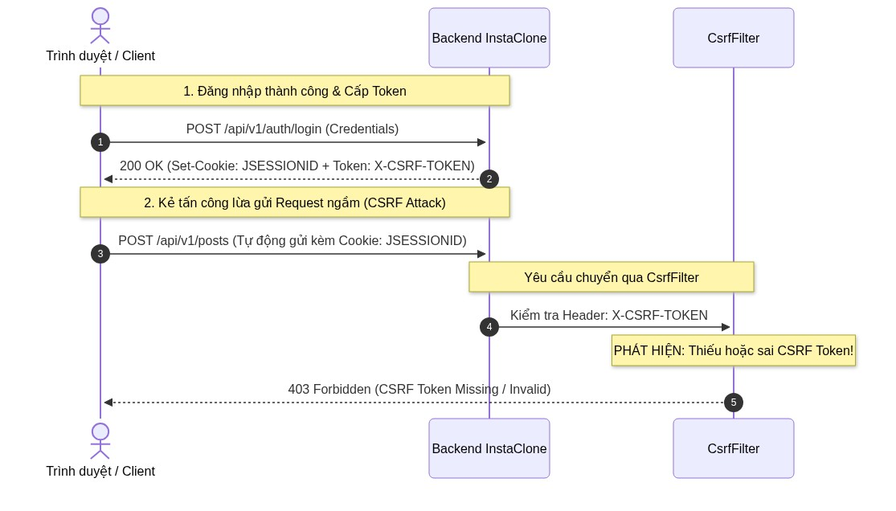

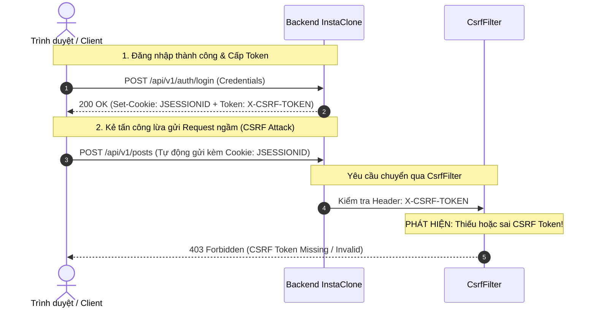

##### Chống tấn công BREACH với `XorCsrfTokenRequestAttributeHandler`

- _Tấn công BREACH:_ Kẻ tấn công có thể đoán được CSRF Token trên đường truyền mã hóa HTTPS nếu server bật tính năng nén HTTP (Gzip/Brotli), bằng cách quan sát sự thay đổi kích thước của các gói tin nén khi chèn các ký tự phỏng đoán.
- _Giải pháp trên Spring Security 7.x:_ Mặc định sử dụng **`XorCsrfTokenRequestAttributeHandler`**. Mỗi lần trả CSRF Token về cho Client, Spring Security sẽ sinh một chuỗi ngẫu nhiên (One-time Pad) và thực hiện phép toán bit `XOR` với CSRF Token gốc. Kết quả là giá trị chuỗi Token trả về ở mỗi request luôn thay đổi ngẫu nhiên, vô hiệu hóa hoàn toàn kỹ thuật phân tích kích thước gói tin của cuộc tấn công BREACH.

#### 2.2. Chiến lược Quản lý Session & Session Fixation Protection

Khi người dùng đăng nhập thành công, Spring Security 7.x cung cấp các cơ chế kiểm soát phiên:

1. **`changeSessionId()` (Chiến lược mặc định):** Giữ nguyên dữ liệu Session nhưng yêu cầu Servlet Container sinh một `JSESSIONID` hoàn toàn mới gán cho người dùng. Kẻ tấn công nắm Session ID cũ sẽ bị đá ra ngoài ngay lập tức.

2. **Concurrent Session Control:** Giới hạn số lượng phiên hoạt động đồng thời của một tài khoản người dùng trên InstaClone. Khi vượt ngưỡng, hệ thống có thể từ chối đăng nhập mới hoặc vô hiệu hóa (expire) phiên đăng nhập cũ nhất.

#### 2.3. Ranh giới CORS (Cross-Origin Resource Sharing)

CORS là cơ chế an ninh do **trình duyệt thực thi** nhằm ngăn không cho mã JavaScript ở một nguồn (Origin A) đọc dữ liệu nhạy cảm từ một nguồn khác (Origin B) nếu không được phép.

- **Preflight Request (`OPTIONS`):** Trước khi gửi các request phức tạp (chứa header tùy biến hoặc method `PUT`/`DELETE`), trình duyệt tự động gửi trước một request `OPTIONS` để hỏi Server xem có cho phép Origin này giao tiếp hay không.

- **Thứ tự của `CorsFilter`:** `CorsFilter` bắt buộc phải được xử lý **trước** các bộ lọc xác thực và phân quyền của Spring Security. Nếu không, các request `OPTIONS` chưa có thông tin đăng nhập sẽ bị `AuthorizationFilter` chặn lại với mã lỗi `401/403` trước khi trình duyệt nhận được CORS Header!

#### 2.4. Bắt buộc kết nối an toàn HTTPS trong 7.x

Trong Spring Security 7.0, cấu hình cũ `http.requiresChannel()` đã **bị xóa bỏ**. Thay vào đó, chuẩn cấu hình mới để ép buộc chuyển hướng toàn bộ kết nối không an toàn (HTTP) sang kết nối mã hóa (HTTPS) là **`http.redirectToHttps(Customizer.withDefaults())`**.

---

### 3. MINH HỌA CODE CHUẨN MỰC TRÊN INSTACLONE

Dưới đây là cấu hình hoàn chỉnh cho hệ thống Web của InstaClone bao gồm bảo vệ Session, phòng chống CSRF, cấu hình CORS và HTTPS chuẩn Spring Security 7.x.

#### 3.1. Cấu hình Toàn diện: CSRF, Session, CORS & HTTPS

```java
package com.instaclone.infrastructure.security.config;

import org.springframework.context.annotation.Bean;
import org.springframework.context.annotation.Configuration;
import org.springframework.security.config.Customizer;
import org.springframework.security.config.annotation.web.builders.HttpSecurity;
import org.springframework.security.config.annotation.web.configuration.EnableWebSecurity;
import org.springframework.security.web.SecurityFilterChain;
import org.springframework.security.web.csrf.CookieCsrfTokenRepository;
import org.springframework.security.web.csrf.XorCsrfTokenRequestAttributeHandler;
import org.springframework.web.cors.CorsConfiguration;
import org.springframework.web.cors.CorsConfigurationSource;
import org.springframework.web.cors.UrlBasedCorsConfigurationSource;

import java.util.List;

@Configuration
@EnableWebSecurity
public class WebDefenseSecurityConfig {

    @Bean
    public SecurityFilterChain webSecurityFilterChain(HttpSecurity http) throws Exception {
        // Cấu hình Handler xử lý CSRF Token với kỹ thuật Masking XOR chống BREACH
        XorCsrfTokenRequestAttributeHandler requestHandler = new XorCsrfTokenRequestAttributeHandler();
        requestHandler.setCsrfRequestAttributeName("_csrf");

        http
            // 1. Ép buộc chuyển hướng HTTP sang HTTPS chuẩn Spring Security 7.x
            .redirectToHttps(Customizer.withDefaults())

            // 2. Cấu hình chia sẻ tài nguyên nguồn gốc chéo (CORS)
            .cors(cors -> cors.configurationSource(corsConfigurationSource()))

            // 3. Phòng thủ CSRF cho ứng dụng Web có sử dụng Cookie
            .csrf(csrf -> csrf
                // Lưu CSRF Token trong Cookie mà JavaScript Client có thể đọc được (HttpOnly = false)
                .csrfTokenRepository(CookieCsrfTokenRepository.withHttpOnlyFalse())
                .csrfTokenRequestHandler(requestHandler)
                // Bỏ qua kiểm tra CSRF cho các API công khai của bên thứ ba (Webhooks)
                .ignoringRequestMatchers("/api/v1/webhooks/**")
            )

            // 4. Quản lý Session và chống tấn công cố định phiên
            .sessionManagement(session -> session
                // Tạo mới Session ID sau khi người dùng đăng nhập thành công
                .sessionFixation(fixation -> fixation.changeSessionId())
                // Giới hạn tối đa 2 thiết bị đăng nhập đồng thời cho mỗi tài khoản
                .maximumSessions(2)
                .maxSessionsPreventsLogin(false) // Đá phiên cũ nhất khi thiết bị thứ 3 đăng nhập
            )

            // 5. Cấu hình các Header an ninh chuẩn OWASP
            .headers(headers -> headers
                .frameOptions(frame -> frame.deny()) // Chống Clickjacking
                .xssProtection(Customizer.withDefaults())
            )

            .authorizeHttpRequests(auth -> auth
                .requestMatchers("/api/v1/feed/public/**", "/api/v1/csrf/**").permitAll()
                .anyRequest().authenticated()
            )
            .httpBasic(Customizer.withDefaults());

        return http.build();
    }

    /**
     * Cấu hình CORS chặt chẽ: Chỉ cho phép Frontend chính thức của InstaClone kết nối.
     */
    @Bean
    public CorsConfigurationSource corsConfigurationSource() {
        CorsConfiguration configuration = new CorsConfiguration();

        // Tuyệt đối không dùng "*" khi allowCredentials = true
        configuration.setAllowedOrigins(List.of("https://instaclone.com", "https://app.instaclone.com"));
        configuration.setAllowedMethods(List.of("GET", "POST", "PUT", "DELETE", "PATCH", "OPTIONS"));
        configuration.setAllowedHeaders(List.of("Authorization", "Content-Type", "X-XSRF-TOKEN"));
        configuration.setExposedHeaders(List.of("X-XSRF-TOKEN"));
        configuration.setAllowCredentials(true); // Cho phép truyền Cookie / Credentials
        configuration.setMaxAge(3600L); // Cache kết quả Preflight trong 1 giờ

        UrlBasedCorsConfigurationSource source = new UrlBasedCorsConfigurationSource();
        source.registerCorsConfiguration("/**", configuration);
        return source;
    }
}

```

#### 3.2. REST Endpoint Cung cấp CSRF Token cho Single Page Application (SPA)

Để ứng dụng Single Page App (React/Angular) chủ động lấy CSRF Token khi khởi tạo:

```java
package com.instaclone.presentation.controller;

import org.springframework.security.web.csrf.CsrfToken;
import org.springframework.web.bind.annotation.GetMapping;
import org.springframework.web.bind.annotation.RequestMapping;
import org.springframework.web.bind.annotation.RestController;

@RestController
@RequestMapping("/api/v1/csrf")
public class CsrfController {

    /**
     * Endpoint trả về CSRF Token.
     * Spring Security tự động nạp đối tượng CsrfToken vào tham số của Controller.
     */
    @GetMapping("/token")
    public CsrfToken getCsrfToken(CsrfToken token) {
        // Trả về JSON chứa: parameterName, headerName, token (đã được XOR mask)
        return token;
    }
}

```

---

### 4. BẪY LỖI KINH ĐIỂN & RỦI RO BẢO MẬT (GOTCHAS & PITFALLS)

- **Bẫy 1: Tắt bừa bãi CSRF (`csrf -> csrf.disable()`) khi ứng dụng dùng Cookie lưu trữ danh tính**

- _Hiện tượng:_ Lập trình viên gặp lỗi 403 khi gọi API `POST`, tìm kiếm trên mạng thấy hướng dẫn tắt CSRF và áp dụng ngay vào dự án mà không hiểu bản chất.

- _Hệ quả:_ Toàn bộ người dùng InstaClone bị đặt vào trạng thái dễ bị tổn thương trước tấn công CSRF. Bất kỳ trang web độc hại nào cũng có thể ép trình duyệt của nạn nhân thực hiện các hành động nguy hiểm.

- _Khắc phục:_ **Chỉ tắt CSRF khi ứng dụng là hoàn toàn Stateless REST API** (nghĩa là mọi request đều truyền Bearer Token qua Header và Server hoàn toàn không dựa vào bất kỳ Cookie nào để nhận diện phiên làm việc). Nếu còn dùng Cookie để nhận diện người dùng, CSRF là yêu cầu sống còn bắt buộc phải bật.

- **Bẫy 2: Cấu hình `allowedOrigins("*")` kết hợp `allowCredentials(true)` trong CORS**
- _Hiện tượng:_ Trình duyệt ném lỗi CORS trên console và từ chối xử lý dữ liệu trả về từ Server:
  _`The value of the 'Access-Control-Allow-Origin' header in the response must not be the wildcard '_' when the request's credentials mode is 'include'.`\*
- _Nguyên nhân:_ Đặc tả kỹ thuật bảo mật của W3C/WHATWG cấm tuyệt đối việc sử dụng ký tự đại diện `*` nếu Server chấp nhận truyền kèm Cookie/Credentials. Điều này nhằm bảo vệ người dùng không bị rò rỉ dữ liệu phiên sang các trang web bất kỳ.

- _Khắc phục:_ Luôn chỉ định danh sách rõ ràng các Domain tin cậy thông qua `setAllowedOrigins(...)` khi bật `allowCredentials(true)`.

- **Bẫy 3: Gặp lỗi 403 Forbidden trên Preflight Request (`OPTIONS`)**
- _Hiện tượng:_ Trình duyệt gửi request `OPTIONS` trước khi gọi `DELETE /api/v1/posts/105`, nhưng Server phản hồi ngay `403 Forbidden` khiến toàn bộ thao tác bị hủy bỏ.
- _Nguyên nhân:_ Tự tạo một bộ lọc CORS thông thường nhưng đặt sai vị trí (chạy sau Spring Security), hoặc không cấu hình `http.cors()` khiến `AuthorizationFilter` coi request `OPTIONS` là một request chưa xác thực và từ chối phục vụ.
- _Khắc phục:_ Luôn cấu hình CORS thông qua DSL chuẩn `http.cors(cors -> cors.configurationSource(...))` để Spring Security tự động tích hợp `CorsFilter` vào vị trí ưu tiên cao nhất trong chuỗi lọc, tự động cho phép các Preflight Request đi qua an toàn.

---

### 5. BỘ CÂU HỎI TƯ DUY & PHẢN BIỆN (DEEP-DIVE QUESTIONS)

1. _Một kỹ sư an ninh nhận định: "Vì chúng ta đã cấu hình CORS chặt chẽ, chỉ cho phép Origin `[https://instaclone.com](https://instaclone.com)`, nên ứng dụng của chúng ta đã miễn nhiễm với tấn công CSRF và có thể tắt CSRF Filter". Lập luận này đúng hay sai? Hãy phân tích sự khác nhau về bản chất và mục đích bảo vệ giữa CORS và CSRF._

2. _Tại sao một REST API hoàn toàn Stateless sử dụng JWT gửi qua Header `Authorization: Bearer <token>` lại không bị tấn công CSRF, trong khi nếu lưu chính JWT đó vào một `HttpOnly` Cookie thì ứng dụng lại ngay lập tức đối mặt với nguy cơ bị tấn công CSRF?_

---

## CHƯƠNG 7: KIẾN TRÚC STATELESS REST API & XÁC THỰC JWT RESOURCE SERVER

### 1. ĐẶT VẤN ĐỀ & CÂU HỎI TRỌNG TÂM

#### Bài toán thực tế trên mạng xã hội InstaClone

Khi InstaClone mở rộng quy mô từ một máy chủ đơn lẻ lên cụm phân tán gồm hàng chục microservices (Post Service, Media Service, Comment Service, Feed Service) phục vụ đồng thời hàng triệu ứng dụng Mobile (iOS/Android) và Web Client, kiến trúc dựa trên Stateful Session (`JSESSIONID`) bộc lộ các nút thắt cổ chai nghiêm trọng:

- **Chi phí đồng bộ phiên làm việc (Session Replication Bottleneck):** Việc duy trì cụm Redis tập trung chỉ để tra cứu session cho mỗi request tạo ra độ trễ mạng (Network I/O) và biến Redis thành điểm nghẽn chịu lỗi duy nhất (Single Point of Failure).
- **Trở ngại đa nền tảng:** Các thiết bị Mobile app không quản lý Cookie tự nhiên như trình duyệt web, đòi hỏi một định dạng token nhỏ gọn, độc lập và dễ nhúng vào các giao thức truyền tải chuẩn.

Để giải quyết, InstaClone chuyển đổi sang kiến trúc **Stateless Authentication** sử dụng JWT (JSON Web Token). Tuy nhiên, nhiều lập trình viên khi triển khai thường mắc các sai lầm tai hại:

1. Tự viết Filter để cắt chuỗi Bearer token, giải mã Base64 thủ công rồi tra cứu lại database ở mỗi request (triệt tiêu hoàn toàn lợi thế Stateless của JWT).
2. Lưu trữ dữ liệu nhạy cảm (mật khẩu, quyền hạn chi tiết chưa kiểm soát) trực tiếp vào Payload của JWT vì lầm tưởng JWT có tính năng che giấu dữ liệu.

3. Đặt thời hạn sống của Access Token quá dài (30 ngày) mà không có cơ chế thu hồi, biến token bị rò rỉ thành một "chìa khóa vạn năng" không thể vô hiệu hóa.

#### Câu hỏi tư duy trọng tâm

> Làm thế nào một máy chủ Resource Server có thể xác thực và tin tưởng tuyệt đối vào thông tin danh tính cùng quyền hạn nằm bên trong một chuỗi JWT mà KHÔNG CẦN truy vấn Database hay bất kỳ hệ thống lưu trữ phân tán nào (Stateless Verification)? Cơ chế hoạt động của bộ đôi Access Token ngắn hạn và Refresh Token giải quyết bài toán cân bằng giữa hiệu năng và khả năng thu hồi quyền như thế nào?

---

### 2. PHÂN TÍCH KIẾN TRÚC & CƠ CHẾ NỘI TẠI (UNDER THE HOOD)

#### 2.1. Cấu trúc và Bản chất Ký số của JWT

Một JSON Web Token bao gồm 3 phần riêng biệt được ngăn cách bởi dấu chấm (`.`):

$$\text{JWT} = \text{Base64URL}(\text{Header}) \,.\, \text{Base64URL}(\text{Payload}) \,.\, \text{Base64URL}(\text{Signature})$$

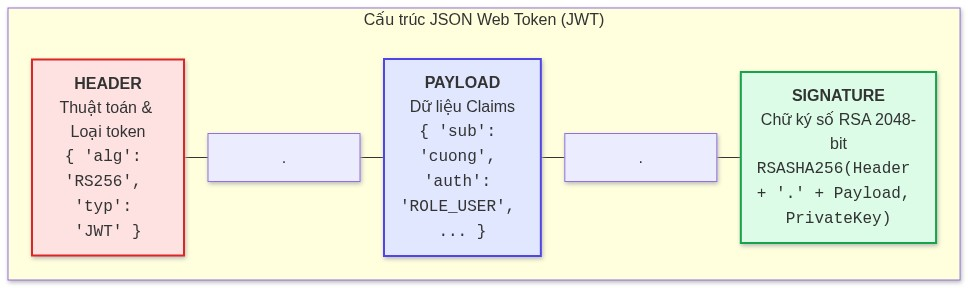

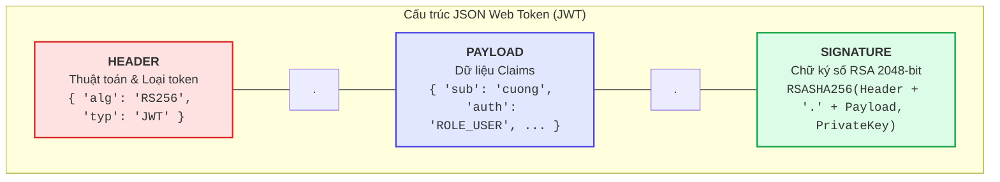

- **Header:** Chứa thuật toán ký (`alg`: `RS256`, `ES256`, hoặc `HS256`) và loại token (`typ`: `JWT`).
- **Payload (Claims):** Chứa dữ liệu danh tính đã thỏa thuận:

- Registered Claims: `sub` (Subject/Username), `iss` (Issuer), `exp` (Expiration Time), `iat` (Issued At).

- Custom Claims: `roles`, `scope`, `userId`.
  _(Cảnh báo: Payload chỉ được mã hóa Base64URL để truyền tải, bất kỳ ai có token đều đọc được nội dung; JWT hoàn toàn không có cơ chế che giấu dữ liệu)_.

- **Signature (Chữ ký số):** Được tạo ra bằng cách lấy $(\text{Header} + "." + \text{Payload})$ băm qua thuật toán mật mã học kết hợp với khóa bí mật:

$$\text{Signature} = \text{Sign}_{K_{private}}(\text{Base64URL}(\text{Header}) + "." + \text{Base64URL}(\text{Payload}))$$

##### Bản chất của Xác thực Bất đối xứng (Asymmetric Signing - RSA/ECDSA)

Trong hệ thống InstaClone chuẩn doanh nghiệp:

- **Authorization Server** nắm giữ **Private Key** để ký phát hành token.
- Các **Resource Server** (Post Service, Comment Service) chỉ cần lưu giữ **Public Key** tương ứng.

- Khi nhận token, Resource Server chỉ cần dùng Public Key để kiểm chứng chữ ký: nếu chữ ký khớp, điều đó khẳng định chắc chắn 100% rằng dữ liệu trong Payload không bị chỉnh sửa giả mạo trên đường truyền và token thực sự do chính chủ phát hành, từ đó cho phép thực thi request mà không cần gọi ngược về Authorization Server hay Database!

#### 2.2. Luồng Xử lý OAuth2 Resource Server trong Spring Security 7.x

Khi sử dụng thư viện chuẩn `spring-boot-starter-oauth2-resource-server`, Spring Security kích hoạt một chuỗi xử lý tinh gọn:

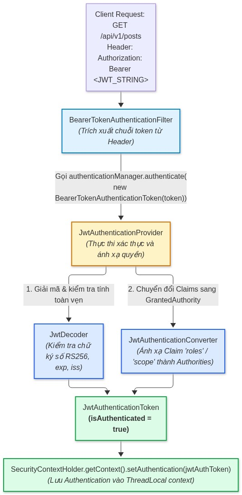

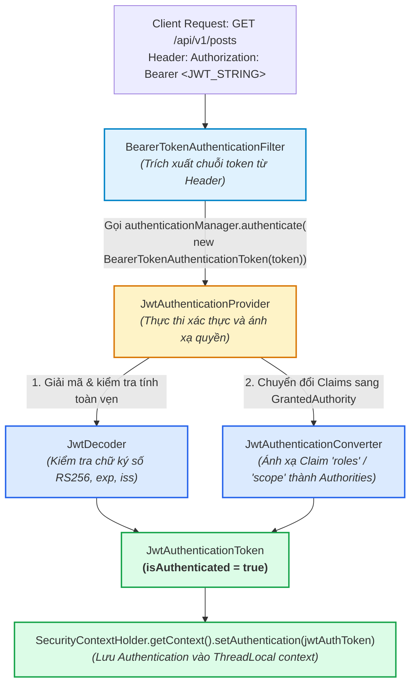

1. **`BearerTokenAuthenticationFilter`:** Lọc request, nhận diện tiền tố `Bearer `, tách lấy chuỗi token thô.

2. **`JwtDecoder`:** Thực hiện:

- Kiểm tra định dạng cấu trúc token.
- Xác thực chữ ký số bằng Public Key (hoặc JWK Set Endpoint).

- Kiểm tra tính hợp lệ về thời gian (`exp` chưa hết hạn, `nbf` đã có hiệu lực, cho phép độ trễ đồng hồ hệ thống `clockSkew` mặc định 60 giây).

- **Chuẩn hóa Spring Security 7.x:** Thực thi thẩm định bắt buộc thuộc tính `typ` trong Header (thường phải là `JWT` hoặc `at+jwt`) để chống lại kiểu tấn công hoán đổi loại token (Token Type Confusion Attack).

3. **`JwtAuthenticationConverter`:** Trích xuất các Claim từ đối tượng `Jwt` đã giải mã để tạo ra danh sách các `GrantedAuthority` (mặc định map từ claim `scope` hoặc `scp`, nhưng có thể tùy biến sang mảng `roles` của InstaClone).

#### 2.3. Quản lý Vòng đời Token: Cặp đôi Access Token / Refresh Token & Thu hồi Token

- **Access Token:** Mang tính chất Stateless, thời gian sống rất ngắn (ví dụ: 15 phút). Được gửi kèm trong mỗi request.

- **Refresh Token:** Lưu trữ an toàn tại Server (Redis/Database), thời gian sống dài (ví dụ: 7 ngày hoặc 30 ngày). Chỉ được gửi đến endpoint duy nhất `/api/v1/auth/refresh` để xin cấp lại cặp Access Token mới.

- **Chiến lược Thu hồi (Token Revocation/Blacklist với Redis):**
  Khi người dùng InstaClone bấm _"Đăng xuất khỏi mọi thiết bị"_:

1. Xóa toàn bộ Refresh Token của người dùng trong cơ sở dữ liệu.
2. Để vô hiệu hóa ngay lập tức Access Token hiện tại (vẫn còn hạn vài phút), Server đẩy định danh `jti` (JWT ID) của token vào Redis Blacklist với thời gian sống (TTL) bằng đúng thời gian còn lại của token. Resource Server kiểm tra nhanh trong Redis (in-memory, $O(1)$) để từ chối các token nằm trong blacklist.

---

### 3. MINH HỌA CODE CHUẨN MỰC TRÊN INSTACLONE

Dưới đây là mã nguồn xây dựng Resource Server xác thực JWT và dịch vụ phát hành token cho InstaClone trên nền tảng Java 21, Spring Boot 4.x và Spring Security 7.x.

#### 3.1. Cấu hình Cặp Khóa RSA (RSA Key Pair Generator / Loader)

Trong môi trường Production, khóa bí mật được nạp từ tệp PEM hoặc Vault/KMS. Dưới đây là cấu hình Spring Bean quản lý cặp khóa RSA:

```java
package com.instaclone.infrastructure.security.config;

import com.nimbusds.jose.jwk.JWK;
import com.nimbusds.jose.jwk.JWKSet;
import com.nimbusds.jose.jwk.RSAKey;
import com.nimbusds.jose.jwk.source.ImmutableJWKSet;
import com.nimbusds.jose.jwk.source.JWKSource;
import com.nimbusds.jose.proc.SecurityContext;
import org.springframework.context.annotation.Bean;
import org.springframework.context.annotation.Configuration;
import org.springframework.security.oauth2.jwt.JwtDecoder;
import org.springframework.security.oauth2.jwt.JwtEncoder;
import org.springframework.security.oauth2.jwt.NimbusJwtDecoder;
import org.springframework.security.oauth2.jwt.NimbusJwtEncoder;

import java.security.KeyPair;
import java.security.KeyPairGenerator;
import java.security.interfaces.RSAPrivateKey;
import java.security.interfaces.RSAPublicKey;
import java.util.UUID;

@Configuration
public class JwtCryptographyConfig {

    private final KeyPair rsaKeyPair;

    public JwtCryptographyConfig() {
        this.rsaKeyPair = generateRsaKeyPair();
    }

    private static KeyPair generateRsaKeyPair() {
        try {
            KeyPairGenerator keyPairGenerator = KeyPairGenerator.getInstance("RSA");
            keyPairGenerator.initialize(2048);
            return keyPairGenerator.generateKeyPair();
        } catch (Exception ex) {
            throw new IllegalStateException("Failed to generate RSA Key Pair", ex);
        }
    }

    @Bean
    public RSAPublicKey rsaPublicKey() {
        return (RSAPublicKey) rsaKeyPair.getPublic();
    }

    @Bean
    public RSAPrivateKey rsaPrivateKey() {
        return (RSAPrivateKey) rsaKeyPair.getPrivate();
    }

    @Bean
    public JwtDecoder jwtDecoder(RSAPublicKey rsaPublicKey) {
        // Cấu hình JwtDecoder với Public Key để Resource Server kiểm chứng chữ ký
        return NimbusJwtDecoder.withPublicKey(rsaPublicKey).build();
    }

    @Bean
    public JwtEncoder jwtEncoder(RSAPublicKey rsaPublicKey, RSAPrivateKey rsaPrivateKey) {
        JWK jwk = new RSAKey.Builder(rsaPublicKey)
                .privateKey(rsaPrivateKey)
                .keyID(UUID.randomUUID().toString())
                .build();
        JWKSource<SecurityContext> jwkSource = new ImmutableJWKSet<>(new JWKSet(jwk));
        return new NimbusJwtEncoder(jwkSource);
    }
}

```

#### 3.2. Cấu hình Chuỗi Lọc Resource Server với Chuyển đổi Claim

```java
package com.instaclone.infrastructure.security.config;

import org.springframework.context.annotation.Bean;
import org.springframework.context.annotation.Configuration;
import org.springframework.http.HttpMethod;
import org.springframework.security.config.Customizer;
import org.springframework.security.config.annotation.web.builders.HttpSecurity;
import org.springframework.security.config.annotation.web.configuration.EnableWebSecurity;
import org.springframework.security.config.http.SessionCreationPolicy;
import org.springframework.security.oauth2.server.resource.authentication.JwtAuthenticationConverter;
import org.springframework.security.oauth2.server.resource.authentication.JwtGrantedAuthoritiesConverter;
import org.springframework.security.web.SecurityFilterChain;

@Configuration
@EnableWebSecurity
public class JwtSecurityConfig {

    @Bean
    public SecurityFilterChain jwtSecurityFilterChain(HttpSecurity http) throws Exception {
        http
            // 1. TẮT CSRF vì đây là kiến trúc hoàn toàn Stateless REST API (Không dùng Session Cookie)
            .csrf(csrf -> csrf.disable())

            // 2. Ép buộc chính sách không lưu trạng thái (STATELESS)
            .sessionManagement(session -> session
                .sessionCreationPolicy(SessionCreationPolicy.STATELESS)
            )

            // 3. Phân quyền đường dẫn URL
            .authorizeHttpRequests(auth -> auth
                .requestMatchers(HttpMethod.POST, "/api/v1/auth/login", "/api/v1/auth/register", "/api/v1/auth/refresh").permitAll()
                .requestMatchers(HttpMethod.GET, "/api/v1/feed/public/**").permitAll()
                .requestMatchers("/api/v1/moderation/**").hasRole("MODERATOR")
                .anyRequest().authenticated()
            )

            // 4. Kích hoạt OAuth2 Resource Server xử lý Bearer Token
            .oauth2ResourceServer(oauth2 -> oauth2
                .jwt(jwt -> jwt.jwtAuthenticationConverter(jwtAuthenticationConverter()))
            );

        return http.build();
    }

    /**
     * Tùy biến JwtAuthenticationConverter để ánh xạ claim custom "roles" trong JWT
     * thành danh sách các SimpleGrantedAuthority có tiền tố ROLE_
     */
    @Bean
    public JwtAuthenticationConverter jwtAuthenticationConverter() {
        JwtGrantedAuthoritiesConverter grantedAuthoritiesConverter = new JwtGrantedAuthoritiesConverter();
        // Chỉ định claim chứa danh sách role
        grantedAuthoritiesConverter.setAuthoritiesClaimName("roles");
        // Giữ nguyên tiền tố ROLE_ đã gắn sẵn trong token
        grantedAuthoritiesConverter.setAuthorityPrefix("");

        JwtAuthenticationConverter jwtConverter = new JwtAuthenticationConverter();
        jwtConverter.setJwtGrantedAuthoritiesConverter(grantedAuthoritiesConverter);
        return jwtConverter;
    }
}

```

#### 3.3. Dịch vụ Phát hành và Quản lý Vòng đời Token (`JwtTokenService`)

```java
package com.instaclone.infrastructure.security.service;

import org.springframework.security.core.Authentication;
import org.springframework.security.core.GrantedAuthority;
import org.springframework.security.oauth2.jwt.JwtClaimsSet;
import org.springframework.security.oauth2.jwt.JwtEncoder;
import org.springframework.security.oauth2.jwt.JwtEncoderParameters;
import org.springframework.stereotype.Service;

import java.time.Instant;
import java.time.temporal.ChronoUnit;
import java.util.List;
import java.util.UUID;

@Service
public class JwtTokenService {

    private final JwtEncoder jwtEncoder;

    public JwtTokenService(JwtEncoder jwtEncoder) {
        this.jwtEncoder = jwtEncoder;
    }

    /**
     * Phát hành Stateless Access Token ngắn hạn (15 phút)
     */
    public String generateAccessToken(Authentication authentication, Long userId) {
        Instant now = Instant.now();
        List<String> roles = authentication.getAuthorities().stream()
                .map(GrantedAuthority::getAuthority)
                .toList();

        JwtClaimsSet claims = JwtClaimsSet.builder()
                .id(UUID.randomUUID().toString()) // jti: JWT ID (dùng cho blacklist nếu cần)
                .issuer("https://api.instaclone.com")
                .issuedAt(now)
                .expiresAt(now.plus(15, ChronoUnit.MINUTES)) // Sống 15 phút
                .subject(authentication.getName())
                .claim("userId", userId)
                .claim("roles", roles)
                .build();

        return this.jwtEncoder.encode(JwtEncoderParameters.from(claims)).getTokenValue();
    }
}

```

---

### 4. BẪY LỖI KINH ĐIỂN & RỦI RO BẢO MẬT (GOTCHAS & PITFALLS)

- **Bẫy 1: Không chuyển đổi `SessionCreationPolicy.STATELESS` dẫn đến rò rỉ phiên**
- _Hiện tượng:_ Ứng dụng đã dùng Bearer Token nhưng Spring Security vẫn âm thầm sinh header `Set-Cookie: JSESSIONID=...` trả về cho Client, gây lãng phí bộ nhớ của Web Server.
- _Nguyên nhân:_ Không thiết lập `sessionCreationPolicy(SessionCreationPolicy.STATELESS)`. Mặc định Spring Security vẫn giữ trạng thái `ALWAYS` hoặc `IF_REQUIRED`.

- _Khắc phục:_ Luôn cấu hình tường minh `.sessionManagement(s -> s.sessionCreationPolicy(SessionCreationPolicy.STATELESS))` trong `SecurityFilterChain`.

- **Bẫy 2: Nhầm lẫn giữa mã `scp` mặc định và Claim tùy biến của ứng dụng**
- _Hiện tượng:_ Token chứa claim `"roles": ["ROLE_USER", "ROLE_MODERATOR"]`, nhưng khi gọi method có `@PreAuthorize("hasRole('MODERATOR')")` thì luôn bị lỗi `403 Forbidden`.

- _Nguyên nhân:_ Mặc định `JwtAuthenticationConverter` chỉ đọc claim có tên `scope` hoặc `scp`, và tự động thêm tiền tố `SCOPE_` (thành `SCOPE_read`, `SCOPE_write`). Do đó, claim `roles` bị bỏ qua hoàn toàn, người dùng không có bất kỳ quyền `ROLE_` nào trong `SecurityContext`!
- _Khắc phục:_ Cấu hình `JwtGrantedAuthoritiesConverter.setAuthoritiesClaimName("roles")` và set `authorityPrefix` chuẩn xác như đã minh họa ở phần code.

- **Bẫy 3: Nguy cơ rò rỉ dữ liệu nhạy cảm qua Base64 URL**
- _Hiện tượng:_ Lập trình viên nhúng `email`, `phoneNumber`, hoặc thậm chí trạng thái tài khoản vào JWT Payload vì nghĩ rằng dữ liệu gửi qua HTTPS là an toàn.

- _Nguyên nhân:_ Token được lưu trữ ở phía Client (LocalStorage, IndexedDB hoặc Mobile Secure Storage). Bất kỳ extension trình duyệt hoặc mã độc XSS nào cũng có thể gọi `JSON.parse(atob(token.split('.')[1]))` để đọc toàn bộ thông tin nhạy cảm của người dùng.

- _Khắc phục:_ Chỉ nhúng các metadata tối thiểu phục vụ kiểm tra quyền (`sub`, `roles`, `userId`, `jti`).

---

### 5. BỘ CÂU HỎI TƯ DUY & PHẢN BIỆN (DEEP-DIVE QUESTIONS)

1. _Trong một hệ sinh thái microservices của InstaClone, tại sao các service nội bộ (như Post Service hay Media Service) chỉ nên giữ RSA Public Key mà không bao giờ được phép tiếp cận RSA Private Key? Điều gì sẽ xảy ra với toàn bộ hệ thống nếu một service vệ tinh bị chiếm quyền điều khiển và làm lộ Private Key?_
2. _So sánh chi phí tính toán và mức độ an toàn giữa việc kiểm tra tính hợp lệ của JWT hoàn toàn offline (dựa trên chữ ký số) và giải pháp kiểm tra trạng thái token online thông qua introspection endpoint hoặc Redis blacklist. InstaClone nên áp dụng giải pháp nào cho các hành động cực kỳ nhạy cảm (như chuyển nhượng quyền sở hữu tài khoản hoặc đổi email)?_

---

---

## CHƯƠNG 8: KIẾN TRÚC HIỆN ĐẠI TRONG SPRING SECURITY 7.x (OAUTH 2.1, MFA, OTT) & KIỂM THỬ BẢO MẬT

### 1. ĐẶT VẤN ĐỀ & CÂU HỎI TRỌNG TÂM

#### Bài toán thực tế trên mạng xã hội InstaClone

Để hoàn thiện nền tảng InstaClone đẳng cấp sản phẩm thương mại, hệ thống cần đáp ứng các tiêu chuẩn công nghiệp hiện đại:

1. **Xác thực mạng xã hội (Social Login):** Cho phép người dùng đăng nhập bằng Google hoặc GitHub một chạm thông qua luồng chuẩn hóa thế hệ mới OAuth 2.1.

2. **Bảo vệ thao tác nhạy cảm bằng Xác thực Đa nhân tố (MFA - Multi-Factor Authentication):** Đối với các hành động mang tính rủi ro cao (như xóa vĩnh viễn tài khoản `DELETE /api/v1/users/me` hoặc đổi mật khẩu), việc chỉ có mật khẩu hay JWT thông thường là không đủ tin cậy. Hệ thống phải ép buộc người dùng cung cấp thêm nhân tố thứ hai (One-Time Token/OTP).

3. **Đăng nhập không mật khẩu (Passwordless Authentication):** Hỗ trợ tính năng Magic Link tiện lợi qua Email thông qua cơ chế One-Time Token (OTT).

4. **Kiểm thử tự động (Security Testing Automation):** Đảm bảo 100% các quy tắc phân quyền, kiểm tra lỗi 401/403 được kiểm thử tự động trong quy trình CI/CD mà không cần phải khởi chạy toàn bộ server thật hay tạo tài khoản rác trong cơ sở dữ liệu.

Tuy nhiên, OAuth 2.0 truyền thống có nhiều kẽ hở nghiêm trọng:

- **Resource Owner Password Credentials Grant (Password Grant)** cho phép Client thu thập trực tiếp mật khẩu của người dùng, phá vỡ nguyên tắc ủy quyền an toàn.
- Kiểu tấn công đánh cắp Authorization Code trên các ứng dụng di động công khai (Native Mobile Apps).

#### Câu hỏi tư duy trọng tâm

> Tại sao đặc tả OAuth 2.1 lại khai tử hoàn toàn Password Grant và bắt buộc áp dụng PKCE (Proof Key for Code Exchange) cho tất cả các loại ứng dụng? Spring Security 7.x triển khai cơ chế Xác thực Đa nhân tố (`@EnableMultiFactorAuthentication`) và kiểm thử MockMvc tích hợp sâu như thế nào?

---

### 2. PHÂN TÍCH KIẾN TRÚC & CƠ CHẾ NỘI TẠI (UNDER THE HOOD)

#### 2.1. Chuẩn hóa OAuth 2.1: Bắt buộc PKCE & Khai tử Password Grant

OAuth 2.1 là sự củng cố và siết chặt các tiêu chuẩn an toàn từ OAuth 2.0:

- **Xóa bỏ hoàn toàn Password Grant & Implicit Grant:** Người dùng không bao giờ được phép nhập mật khẩu trực tiếp vào ứng dụng Client.

- **Bắt buộc PKCE (Proof Key for Code Exchange):** Trước đây PKCE chỉ áp dụng cho Single Page Apps (SPA) và Mobile Apps. Trong OAuth 2.1 và Spring Security 7.x, PKCE là **bắt buộc cho tất cả các luồng Authorization Code**, kể cả Web Apps truyền thống chạy trên server.

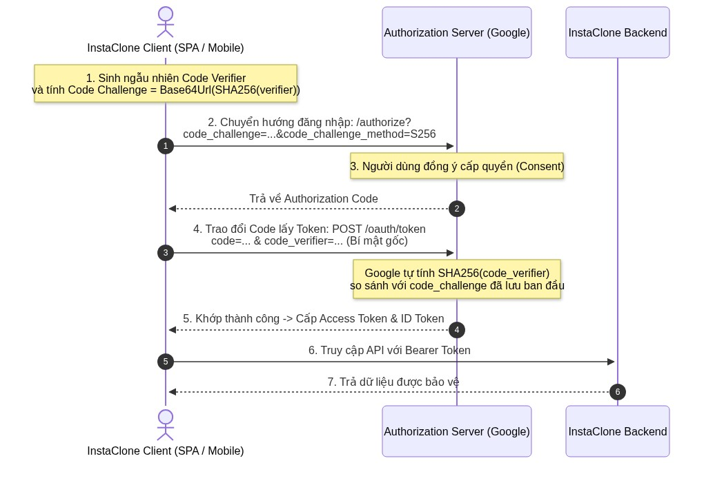

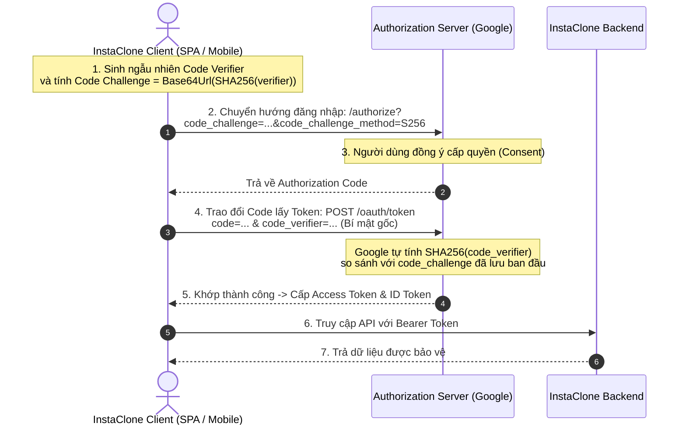

_Tác dụng của PKCE:_ Nếu kẻ tấn công trên điện thoại đánh cắp được Authorization Code từ Custom URI Scheme, chúng cũng không thể đổi lấy Token vì không có `code_verifier` ban đầu!

#### 2.2. Kiến trúc Xác thực Đa nhân tố (MFA) Mới trong Spring Security 7.x

Trước phiên bản 7.0, việc triển khai MFA đòi hỏi lập trình viên phải tự quản lý trạng thái phiên đăng nhập dở dang (Pre-authenticated state) rất phức tạp.
Spring Security 7.x giới thiệu tính năng tích hợp sẵn mang tính đột phá:

- **`@EnableMultiFactorAuthentication`**: Kích hoạt bộ xử lý đa nhân tố toàn diện cho ứng dụng.

- **`FactorGrantedAuthority`**: Đại diện cho từng nhân tố bảo mật mà người dùng đã hoàn thành trong phiên làm việc (ví dụ: `FACTOR_PASSWORD`, `FACTOR_OTT`, `FACTOR_TOTP`).

- **`AllRequiredFactorsAuthorizationManager`**: Một `AuthorizationManager` chuyên biệt giám sát các endpoint nhạy cảm; nó chỉ cấp quyền truy cập nếu danh sách `Authentication` của người dùng sở hữu đủ tập hợp các nhân tố bắt buộc.

#### 2.3. Cơ chế Đăng nhập Một lần: One-Time Token (OTT)

Spring Security 7.x bổ sung DSL chuẩn **`http.oneTimeTokenLogin()`**:

1. Người dùng yêu cầu đăng nhập bằng email: `POST /ott/generate` kèm email.
2. Spring Security sinh ra một token dùng một lần ngẫu nhiên có hạn sử dụng ngắn (ví dụ: 5 phút), nạp vào `OneTimeTokenService`.
3. Một `OneTimeTokenGenerationSuccessHandler` được kích hoạt để gửi token (dưới dạng mã số hoặc liên kết Magic Link) qua email của người dùng.
4. Người dùng bấm liên kết hoặc gửi lại mã: `POST /login/ott?token=...`. Bộ lọc `OneTimeTokenAuthenticationFilter` xác minh token, hủy bỏ token ngay lập tức (chống Replay Attack) và thiết lập trạng thái xác thực.

#### 2.4. Triết lý Kiểm thử Bảo mật với `spring-security-test`

Kiểm thử tầng bảo mật không nên khởi chạy toàn bộ server mạng (tránh chậm trễ). Spring Security cung cấp các công cụ giả lập ngữ cảnh:

- **`@WithMockUser`**: Giả lập tức thì một `UsernamePasswordAuthenticationToken` trong `SecurityContextHolder` với username, role tùy chọn mà không cần query database.

- **`@WithUserDetails`**: Bắt buộc hệ thống phải gọi hàm `UserDetailsService.loadUserByUsername()` có thật từ database/test-fixture để nạp Principal thực tế (dùng khi Controller phụ thuộc vào các trường tùy biến trong `InstaCloneUserDetails`).

- **`SecurityMockMvcRequestPostProcessors.jwt()`**: Tiêm giả lập một `JwtAuthenticationToken` hoàn chỉnh vào request MockMvc, hỗ trợ cấu hình tùy biến claim `roles`, `sub`, `userId` trực tiếp trong mã test.

---

### 3. MINH HỌA CODE CHUẨN MỰC TRÊN INSTACLONE

Dưới đây là mã nguồn toàn diện triển khai OAuth2 Client, One-Time Token Login, Phân quyền MFA cho thao tác nhạy cảm và các ca kiểm thử bảo mật tự động của InstaClone.

#### 3.1. Cấu hình Toàn diện: OAuth 2.1, One-Time Token & MFA Chuẩn 7.x

```java
package com.instaclone.infrastructure.security.config;

import org.springframework.context.annotation.Bean;
import org.springframework.context.annotation.Configuration;
import org.springframework.http.HttpMethod;
import org.springframework.security.authentication.ott.OneTimeToken;
import org.springframework.security.config.Customizer;
import org.springframework.security.config.annotation.method.configuration.EnableMethodSecurity;
import org.springframework.security.config.annotation.web.builders.HttpSecurity;
import org.springframework.security.config.annotation.web.configuration.EnableWebSecurity;
import org.springframework.security.core.authority.FactorGrantedAuthority;
import org.springframework.security.web.SecurityFilterChain;
import org.springframework.security.web.authentication.ott.OneTimeTokenGenerationSuccessHandler;

@Configuration
@EnableWebSecurity
@EnableMethodSecurity(prePostEnabled = true)
public class AdvancedSecurityConfig {

    @Bean
    public SecurityFilterChain advancedSecurityFilterChain(HttpSecurity http) throws Exception {
        http
            .csrf(csrf -> csrf.disable()) // Giả định môi trường API / SPA

            // 1. Phân quyền Request-level
            .authorizeHttpRequests(auth -> auth
                .requestMatchers("/api/v1/feed/public/**", "/ott/generate").permitAll()
                // THAO TÁC NHẠY CẢM: Xóa tài khoản bắt buộc phải có nhân tố xác thực thứ hai (OTT)
                .requestMatchers(HttpMethod.DELETE, "/api/v1/users/me").hasAuthority("FACTOR_OTT")
                .anyRequest().authenticated()
            )

            // 2. Kích hoạt OAuth 2.1 Social Login (Mặc định bắt buộc PKCE)
            .oauth2Login(oauth2 -> oauth2
                .defaultSuccessUrl("/api/v1/users/me", true)
            )

            // 3. Chuẩn 7.x: Đăng nhập Một lần (One-Time Token / Magic Link)
            .oneTimeTokenLogin(ott -> ott
                .tokenGeneratingUrl("/ott/generate") // Endpoint Client gửi email xin mã
                .showComponents(false)
                .tokenGenerationSuccessHandler(magicLinkEmailHandler())
            )

            .httpBasic(Customizer.withDefaults());

        return http.build();
    }

    /**
     * Handler tiếp nhận OTT vừa sinh ra và tiến hành gửi email Magic Link tới người dùng
     */
    @Bean
    public OneTimeTokenGenerationSuccessHandler magicLinkEmailHandler() {
        return (request, response, oneTimeToken) -> {
            String tokenValue = oneTimeToken.getTokenValue();
            String username = oneTimeToken.getUsername();

            // Trong thực tế: Tiêm EmailService để gửi link "https://instaclone.com/login/ott?token=" + tokenValue
            System.out.printf("[InstaClone Notification] Magic Link gửi tới %s: https://instaclone.com/login/ott?token=%s%n",
                    username, tokenValue);

            response.setContentType("application/json");
            response.getWriter().write("""
                {
                    "message": "One-time login token has been dispatched to your email."
                }
                """);
        };
    }
}

```

#### 3.2. REST Controller Thao Tác Nhạy Cảm (Xóa Tài Khoản)

```java
package com.instaclone.presentation.controller;

import org.springframework.http.ResponseEntity;
import org.springframework.security.access.prepost.PreAuthorize;
import org.springframework.security.core.Authentication;
import org.springframework.web.bind.annotation.DeleteMapping;
import org.springframework.web.bind.annotation.RequestMapping;
import org.springframework.web.bind.annotation.RestController;

import java.util.Map;

@RestController
@RequestMapping("/api/v1/users")
public class UserManagementController {

    /**
     * API xóa tài khoản cá nhân vĩnh viễn.
     * Bảo vệ tầng sâu: Bắt buộc đã xác thực và sở hữu nhân tố FACTOR_OTT từ Spring Security 7.x
     */
    @DeleteMapping("/me")
    @PreAuthorize("hasAuthority('FACTOR_OTT')")
    public ResponseEntity<?> deleteMyAccount(Authentication authentication) {
        String username = authentication.getName();
        // Thực thi nghiệp vụ xóa tài khoản và media liên quan của InstaClone
        return ResponseEntity.ok(Map.of(
            "status", "DELETED",
            "message", "User account " + username + " and all associated data have been permanently purged."
        ));
    }
}

```

#### 3.3. Bộ Kiểm Thử Tự Động Toàn Diện với MockMvc (`PostControllerSecurityTest`)

Dưới đây là lớp kiểm thử integration test sử dụng `spring-security-test`, xác minh đầy đủ các trạng thái `401 Unauthorized`, `403 Forbidden` và `200 OK` cho hành vi xóa bài đăng chống BOLA/IDOR và phân quyền Moderator:

```java
package com.instaclone.presentation.controller;

import com.instaclone.application.service.PostService;
import com.instaclone.infrastructure.security.config.SecurityConfig;
import org.junit.jupiter.api.DisplayName;
import org.junit.jupiter.api.Test;
import org.springframework.beans.factory.annotation.Autowired;
import org.springframework.boot.test.autoconfigure.web.servlet.WebMvcTest;
import org.springframework.boot.test.mock.mockito.MockBean;
import org.springframework.context.annotation.Import;
import org.springframework.security.test.context.support.WithMockUser;
import org.springframework.test.web.servlet.MockMvc;

import static org.mockito.Mockito.doNothing;
import static org.mockito.Mockito.doThrow;
import static org.springframework.security.test.web.servlet.request.SecurityMockMvcRequestPostProcessors.jwt;
import static org.springframework.test.web.servlet.request.MockMvcRequestBuilders.delete;
import static org.springframework.test.web.servlet.request.MockMvcRequestBuilders.get;
import static org.springframework.test.web.servlet.result.MockMvcResultMatchers.status;

@WebMvcTest(controllers = PostController.class)
@Import(SecurityConfig.class) // Nạp cấu hình bảo mật vào ngữ cảnh test
class PostControllerSecurityTest {

    @Autowired
    private MockMvc mockMvc;

    @MockBean
    private PostService postService;

    @Test
    @DisplayName("1. Truy cập Feed công khai không cần đăng nhập -> Trả về 200 OK")
    void getPublicFeed_Anonymous_Returns200() throws Exception {
        mockMvc.perform(get("/api/v1/feed/public/explore"))
                .andExpect(status().isOk());
    }

    @Test
    @DisplayName("2. Xóa bài viết khi chưa đăng nhập (Unauthenticated) -> Trả về 401 Unauthorized")
    void deletePost_Unauthenticated_Returns401() throws Exception {
        mockMvc.perform(delete("/api/v1/posts/100"))
                .andExpect(status().isUnauthorized());
    }

    @Test
    @DisplayName("3. Người dùng Bob xóa bài của Alice (BOLA Attack) -> Bị chặn với 403 Forbidden")
    @WithMockUser(username = "bob", roles = {"USER"})
    void deletePost_NotOwner_Returns403() throws Exception {
        // Giả lập PostService ném AccessDeniedException do @PreAuthorize ngăn chặn
        doThrow(new org.springframework.security.access.AccessDeniedException("Not your post!"))
                .when(postService).deletePost(105L);

        mockMvc.perform(delete("/api/v1/posts/105"))
                .andExpect(status().isForbidden());
    }

    @Test
    @DisplayName("4. Kiểm duyệt viên xóa bài vi phạm -> Trả về 200 OK")
    @WithMockUser(username = "mod_alice", roles = {"MODERATOR"})
    void deletePost_AsModerator_Returns200() throws Exception {
        doNothing().when(postService).deletePost(105L);

        mockMvc.perform(delete("/api/v1/posts/105"))
                .andExpect(status().isOk());
    }

    @Test
    @DisplayName("5. Kiểm thử với Stateless JWT PostProcessor: Quyền Admin -> Trả về 200 OK")
    void deletePost_WithStatelessJwt_Returns200() throws Exception {
        doNothing().when(postService).deletePost(105L);

        // Giả lập trực tiếp một JWT Token có chứa claim roles = ROLE_ADMIN
        mockMvc.perform(delete("/api/v1/posts/105")
                .with(jwt().jwt(builder -> builder
                        .claim("sub", "admin_super")
                        .claim("roles", "ROLE_ADMIN")
                )))
                .andExpect(status().isOk());
    }
}

```

---

### 4. BẪY LỖI KINH ĐIỂN & RỦI RO BẢO MẬT (GOTCHAS & PITFALLS)

- **Bẫy 1: Thất bại kiểm thử do thiếu CSRF Token trong các request thay đổi trạng thái (POST/PUT/DELETE)**

- _Hiện tượng:_ Viết test MockMvc cho `delete("/api/v1/posts/1")` với `@WithMockUser(roles="ADMIN")`, kết quả mong đợi là `200 OK` nhưng MockMvc luôn trả về `403 Forbidden`!

- _Nguyên nhân:_ Môi trường ứng dụng vẫn đang bật CSRF. Mặc dù người dùng đã có đủ quyền hạn thông qua `@WithMockUser`, request gửi đi thiếu mã CSRF Token nên `CsrfFilter` đã ngắt request và ném mã lỗi 403 trước khi request chạm tới `AuthorizationFilter` hay `PostService`!

- _Cách debug & sửa:_ Thêm post-processor `.with(csrf())` vào request kiểm thử:

```java
mockMvc.perform(delete("/api/v1/posts/1").with(csrf()))
       .andExpect(status().isOk());

```

- **Bẫy 2: Dùng sai `@WithMockUser` thay vì `@WithUserDetails` khi Controller ép kiểu Principal**

- _Hiện tượng:_ Test chạy thất bại với ngoại lệ `ClassCastException: org.springframework.security.core.userdetails.User cannot be cast to com.instaclone.infrastructure.security.model.InstaCloneUserDetails`.
- _Nguyên nhân:_ `@WithMockUser` chỉ tạo một thực thể `User` chuẩn mặc định của Spring Security. Nếu trong Controller hoặc Custom Evaluator của InstaClone có đoạn code:
  `InstaCloneUserDetails user = (InstaCloneUserDetails) authentication.getPrincipal();`
  việc ép kiểu sẽ gãy đổ hoàn toàn.

- _Cách khắc phục:_ Chuyển sang sử dụng `@WithUserDetails(value = "cuong_admin", userDetailsServiceBeanName = "instaCloneUserDetailsService")` để nạp đúng đối tượng triển khai thực tế của ứng dụng.

- **Bẫy 3: Sử dụng giá trị Redirect URI lỏng lẻo trong OAuth 2.1 (Open Redirector Attack)**
- _Hiện tượng:_ Cấu hình `redirect_uri` phía máy chủ ủy quyền dùng ký tự đại diện wildcard (ví dụ: `https://*[.instaclone.com/](https://.instaclone.com/)*`).
- _Nguy cơ:_ Kẻ tấn công có thể lợi dụng một subdomain bị chiếm quyền hoặc một trang chuyển hướng trung gian để chiếm đoạt chuỗi Authorization Code hoặc Token trên đường callback.
- _Cách khắc phục:_ Theo chuẩn bắt buộc của OAuth 2.1, các Redirect URI phải được cấu hình **chính xác tuyệt đối 100% từng ký tự** (Exact String Matching), nghiêm cấm mọi hình thức dùng regex hoặc wildcard.

---

### 5. BỘ CÂU HỎI TƯ DUY & PHẢN BIỆN (DEEP-DIVE QUESTIONS)

1. _Phân tích sự khác biệt về mặt kiến trúc và luồng xử lý giữa việc kiểm thử Controller với `@WebMvcTest` (sử dụng MockMvc giả lập) và kiểm thử với `@SpringBootTest(webEnvironment = RANDOM_PORT)` kết hợp `TestRestTemplate`. Khi nào bắt buộc phải dùng `@SpringBootTest` để kiểm tra toàn diện chuỗi lọc của Spring Security?_
2. _Trong kịch bản người dùng InstaClone đăng nhập bằng One-Time Token (OTT qua email), hãy phân tích rủi ro bảo mật nếu giá trị token được gửi qua phương thức HTTP GET (dưới dạng query parameter trong Magic Link) so với gửi qua HTTP POST body. Máy chủ proxy hoặc nhật ký truy cập (Access Log) của Web Server có thể làm lộ lọt token như thế nào, và Spring Security 7.x giải quyết bài toán này ra sao?_
